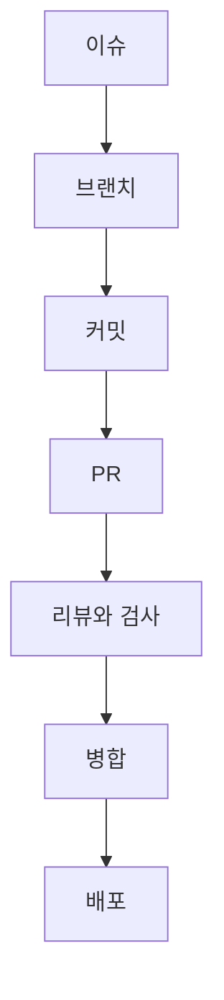

# 1교시. GitHub 리마인드와 Copilot 시작

!!! abstract "이번 교시의 목표"
    GitHub 협업 흐름을 다시 떠올리고, VS Code에서 Copilot을 켜고 안전하게 설정할 수 있습니다.

| 구간 | 시간 |
|---|---|
| 이론: GitHub 리마인드 | 10분 |
| 이론: VS Code 화면 | 5분 |
| 이론: Copilot 소개 | 10분 |
| 실습 1-1 ~ 1-3 | 25분 |

실습 페이지:

- [실습 1-1 환경 점검과 Copilot 설정](lab-1.md)
- [실습 1-2 내 리포지토리 만들고 VS Code 익히기](lab-2.md)
- [실습 1-3 Copilot에게 첫 질문](lab-3.md)

## 교안 { #lecture }

### GitHub에서 일은 이 순서로 흐릅니다

GitHub에서 일은 이 순서로 흘러요. 할 일을 이슈로 만들고, 브랜치라는 따로 작업할 갈래를 만들어서 고치고, 커밋으로 기록해요. 다 됐으면 PR, 즉 '이 변경을 반영해 주세요'라는 요청을 열고, 사람의 리뷰와 자동 테스트를 거쳐 main에 병합해요. 병합하면 Actions가 웹페이지를 다시 배포해요. 오늘 Copilot은 이 모든 단계에 들어와요. 이슈를 정리하고, 코드를 고치고, PR을 요약하고, 리뷰하고, 배포 설정까지 만들어요.

### 리포지토리는 파일과 변경 이력을 함께 담습니다

리포지토리는 프로젝트 폴더예요. 파일뿐 아니라 그 파일이 어떻게 바뀌어 왔는지, 이력을 함께 담아요. 하나하나의 기록이 커밋이고, 커밋마다 누가 언제 무엇을 왜 바꿨는지가 남아요. 오늘 중요한 점 하나는, Copilot이 파일을 고쳐도 그건 아직 내 컴퓨터의 파일이 바뀐 것뿐이라는 거예요. 내가 검토하고 커밋해야 기록이 되고, push해야 GitHub에 올라가요.

### VS Code에서는 내 컴퓨터와 GitHub를 오가며 일합니다

GitHub는 웹 화면에서 바로 고칠 수도 있지만, 오늘은 VS Code를 써요. 그래서 내 컴퓨터와 GitHub를 오가요. 처음에 GitHub의 리포지토리를 내 컴퓨터로 clone해서 가져오고, VS Code에서 Copilot과 함께 고친 다음 커밋해요. 그 커밋을 push로 GitHub에 올리고, 팀원이 올린 변경은 pull로 받아요. VS Code에서는 왼쪽 소스 제어 화면의 버튼으로 이걸 해요. 명령어를 외울 필요는 없어요.

!!! info "화면에서 보게 될 이름표"
    - **커밋 해시**: 커밋마다 붙는 고유 번호입니다. `f7a1c2e`처럼 앞 몇 자리로 줄여 씁니다.
    - **origin**: GitHub 리포지토리의 별명입니다. `main`은 내 PC의 main, `origin/main`은 GitHub의 main입니다.
    - **HEAD**: 내가 지금 있는 곳입니다. `HEAD -> main`이면 지금 main에서 일하고 있다는 뜻입니다.

    `main`과 `origin/main`이 같은 커밋을 가리키면 push가 끝난 것입니다. 실습 2-3에서 처음 push한 뒤 직접 확인합니다.

### 브랜치에서 고치고, PR로 검토받아 합칩니다

main은 늘 동작하는 상태로 두는 게 약속이에요. 그래서 새 기능이나 버그 수정은 브랜치를 만들어 그 위에서 해요. 4교시에 우리는 overlap-check라는 브랜치를 만들어 겹치는 예약을 막는 기능을 넣을 거예요. 다 되면 PR을 열고, 자동 테스트와 리뷰를 통과하면 main에 병합해요. 에이전트가 코드를 대신 써 줄수록 이 검토 단계가 더 중요해져요.

### 이슈 번호로 요구와 변경이 이어집니다

요구사항은 이슈로 남겨요. 이슈마다 번호가 붙고, PR 본문에 'Closes #3'처럼 쓰면 PR이 병합될 때 이슈가 자동으로 닫혀요. 이렇게 요구와 변경이 번호로 이어져요. 오늘 5교시에 팀이 이슈를 만들고, 각자 이슈 번호로 브랜치를 만들어 구현해요. Copilot Chat에는 이슈를 맥락으로 붙일 수도 있어서, 요구사항을 다시 타이핑할 필요가 줄어요.

### Actions와 Pages: 오늘 마지막에 완성할 CI/CD

GitHub Actions는 '이런 일이 생기면 이 작업을 자동으로 해라'를 정해 두는 기능이에요. Starter에는 PR이 열릴 때마다 테스트를 자동으로 돌리는 워크플로가 이미 들어 있어요. 이게 CI, 지속적 통합이에요. 그리고 6교시에는 Copilot에게 배포 워크플로를 만들게 해서, main에 병합하면 예약 현황판 웹페이지가 GitHub Pages로 자동 배포되게 만들어요. 이게 CD, 지속적 배포예요. 오늘 하루의 마지막 결과물이 바로 이 CI/CD예요.

### GitHub Copilot은 세 곳에서 씁니다

지금까지 본 협업 과정의 어느 단계에서 Copilot이 도와주는지 볼게요. GitHub Copilot은 AI 코딩 도우미예요. 오늘의 주 무대는 VS Code예요. 코드를 쓰는 중에 회색으로 다음 내용을 제안하는 인라인 제안, 대화로 묻고 시키는 Chat, 스스로 계획하고 파일을 고치고 명령을 실행하는 에이전트가 있어요. github.com에서는 PR을 요약하고 코드 리뷰를 하고, 이슈를 맡기면 클라우드에서 작업해 PR을 열어 주는 클라우드 에이전트도 있어요. 터미널에서 쓰는 Copilot CLI도 있어요. 이건 7교시에 소개만 할게요.

### Copilot은 내 요청과 맥락을 모아 답을 만듭니다

Copilot이 답을 만드는 과정을 간단히 보면, 내 요청에 맥락을 붙여서 언어 모델에 보내고, 모델이 만든 결과를 돌려받아요. 맥락은 지금 열려 있는 파일, 내가 첨부한 파일, 지침 파일, 지금까지의 대화 같은 것들이에요. 언어 모델은 사실을 찾아보는 게 아니라 가장 그럴듯한 다음 내용을 만들어 내요. 그래서 맥락이 좋을수록 답이 좋아지고, 맥락에 없는 건 그럴듯하게 지어낼 수 있어요. 3교시에 이걸 직접 확인해요. GH-300 시험에서도 데이터 흐름과 한계가 한 영역이에요.

### Copilot Pro는 매월 AI Credits 1,500을 씁니다

| 구분 | 기능 | 크레딧 |
|---|---|---|
| 무제한 | 인라인 제안(코드 완성), 다음 편집 제안 | 쓰지 않음 |
| 차감 | Chat, 에이전트, Copilot CLI, 클라우드 에이전트 | 모델과 사용량만큼 |
| 차감 (큰 편) | 코드 리뷰: 1회 평균 약 1.5달러 (Balanced 기준) | 약 150 |

오늘 쓰는 라이선스는 Copilot Pro예요. 2026년 6월부터 GitHub는 Copilot 사용량을 AI Credits로 계산해요. Pro는 매월 1,500 크레딧이 있고, 1 크레딧은 0.01달러예요. 코드를 쓰다 보면 나오는 인라인 제안과 다음 편집 제안은 무제한이라 크레딧을 쓰지 않아요. Chat과 에이전트, CLI, 클라우드 에이전트는 쓴 모델과 양만큼 차감돼요. 코드 리뷰는 한 번에 평균 1.5달러 정도라 오늘은 각자 한 번만 써요. 모델은 Auto로 두세요. 알맞은 모델을 골라 주고 10% 할인도 돼요. 크레딧은 매월 1일에 초기화되고 이월되지 않아요.

### 업무에 쓰기 전에 설정 두 개를 확인합니다

개인 플랜으로 회사 업무를 할 때는 설정 두 개를 꼭 확인해요. 첫째, 공개 코드와 일치하는 제안이에요. Block으로 두면 공개된 코드와 똑같은 제안을 막고, Allow로 두면 보여 주되 출처와 라이선스를 함께 보여 줘요. 오늘은 Block으로 해요. 둘째, 내 데이터를 AI 모델 학습에 쓰는 설정이에요. GitHub 문서에 따르면 2026년 4월 24일부터 Free, Pro 같은 개인 플랜은 상호작용이 학습에 쓰일 수 있는 게 기본값이에요. 회사 업무에 쓴다면 Disabled로 꺼 두세요. 회사가 Business나 Enterprise 라이선스를 쓰면 이 설정은 해당되지 않아요. 실습 1-1에서 같이 바꿔요.

!!! tip "핵심"
    공개 코드는 Block, 학습 사용은 Disabled.

### VS Code 화면은 여섯 곳만 알면 됩니다

| 이름 | 어디에 | 하는 일 |
|---|---|---|
| Activity Bar | 맨 왼쪽 아이콘 줄 | 보기 바꾸기 |
| Primary Side Bar | 왼쪽 | 탐색기, 소스 제어 |
| Editor | 가운데 | 파일을 읽고 고치기 |
| Secondary Side Bar | 오른쪽 | 기본으로 Chat |
| Panel | 아래 | 터미널, 문제 |
| Status Bar | 맨 아래 줄 | 브랜치 이름, Copilot 아이콘 |

단축키는 [VS Code와 Copilot 한 장 정리](../appendix/vscode-copilot.md)에 있습니다.

Copilot을 보기 전에 VS Code 화면부터 익혀요. 처음 쓰시는 분이 많아서 천천히 할게요. 맨 왼쪽 아이콘 줄이 Activity Bar예요. 누르면 옆의 Primary Side Bar가 탐색기나 소스 제어로 바뀌어요. 가운데가 파일을 고치는 Editor, 오른쪽 Secondary Side Bar에 Copilot Chat이 기본으로 있어요. 아래 Panel에 터미널이 있고, 맨 아래 줄 Status Bar에 지금 브랜치와 Copilot 아이콘이 보여요. 단축키는 다섯 개만 쓸게요. 모든 명령을 찾는 명령 팔레트 하나만 외워도 메뉴를 몰라도 돼요. 이 그림은 구조를 그린 것이고, 실제 화면은 제 화면으로 같이 볼게요. 실습 1-2에서 직접 눌러 봐요.

### VS Code에서 Copilot은 여기에 있습니다

VS Code에서 Copilot은 여기에 있어요. 아래쪽 상태 표시줄의 Copilot 아이콘으로 로그인하고 사용량을 봐요. Chat 보기는 Mac은 Control Command I, Windows는 Ctrl Alt I로 열어요. 채팅 입력 칸 주변에 선택할 게 몇 개 있어요. Session Target은 하네스라고 하는데, Copilot이 일하는 엔진 같은 거예요. 오늘은 기본인 Copilot을 쓰고, 3교시 프롬프트 파일만 Local을 써요. Agent 선택기에서 역할을 고르는데, Ask는 묻기만, Agent는 직접 고치기예요. 계획 세우기는 선택기에 없고 /plan 명령으로 불러요. 선택기 목록에 다른 이름이 더 보이면 설치한 확장이 추가한 사용자 지정 에이전트예요. 오늘은 쓰지 않아요. 모델은 Auto, 권한은 Manual로 둬요. Manual이면 자동 승인되지 않은 작업은 나에게 확인을 요청해요. 읽기만 하는 명령처럼 자동으로 넘어가는 것도 있으니, 승인창이 안 떠도 설정 오류가 아니에요. 승인창이 뜨면 범위와 명령을 읽어요.

## 실습

- [실습 1-1 환경 점검과 Copilot 설정](lab-1.md)
- [실습 1-2 내 리포지토리 만들고 VS Code 익히기](lab-2.md)
- [실습 1-3 Copilot에게 첫 질문](lab-3.md)
