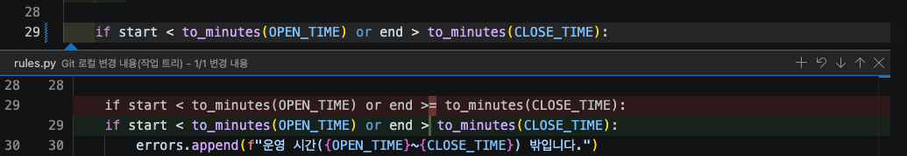

# 실습 2-3. 버그 잡기와 커밋

!!! abstract "이 실습에서 할 일"
    - "18:00에 끝나는 예약이 안 된다"는 버그를 직접 재현합니다.
    - 운영 규칙 문서를 근거로 Copilot(**Agent** 역할)에게 고치게 하고, 바뀐 내용을 검토합니다.
    - 다시 실행하고 테스트로 검증한 뒤, 커밋하고 GitHub에 올려 자동 테스트("테스트")가 초록인지 확인합니다.

    **예상 시간** 약 14분

## 준비

- `room-practice`가 VS Code에 열려 있고, 소스 제어 **Changes** 목록이 비어 있어야 합니다.
- 이 실습은 `main`에 바로 커밋합니다. 4교시부터는 브랜치를 만들어 작업합니다.

## STEP 1. 버그 재현하기

1. 터미널을 엽니다(Windows ``Ctrl+` ``, Mac ``⌃` ``).
2. 소회의실 B에 17:00~18:00 예약을 넣어 봅니다. 한 줄로 붙여 넣고 Enter를 누릅니다.

    ```bash
    python -m booking add --room R2 --title 마감회의 --date 2026-11-10 --start 17:00 --end 18:00 --booker 홍길동 --attendees 2
    ```

    ```text
    [예약 실패]
     - 운영 시간(09:00~18:00) 밖입니다.
    ```

3. 파일을 열지 않고 Chat에서 운영 규칙을 확인합니다. Chat 보기를 열고(Windows `Ctrl+Alt+I`, Mac `⌃⌘I`) **+**(**New Chat**) → 역할 **Ask**를 고릅니다.
4. 입력 칸에 `#02_현행`까지 치면 파일 목록이 좁혀집니다. `↑` `↓`로 `02_현행_업무.md`를 고르고 `Enter`를 누릅니다. 입력 칸 위에 파일이 붙습니다.
5. 이어서 입력하고 Enter를 누릅니다.

    ```text
    이 파일의 운영 규칙만 정리해 주세요. 운영 시간 규칙은 원문 문장을 그대로 인용해 주세요.
    ```


확인: 답에 인용된 운영 규칙은 "09:00~18:00 (18:00에 끝나는 예약은 가능)"입니다. 인용이 이 문장과 다르면 답을 믿지 말고 파일을 열어 확인합니다. 규칙은 이렇게 적혀 있는데, 프로그램은 17:00~18:00 예약을 막습니다. 규칙과 프로그램이 다르므로 **버그**입니다.

## STEP 2. Agent 역할로 고치기 요청

1. Chat 보기를 엽니다(Windows `Ctrl+Alt+I`, Mac `⌃⌘I`).
2. **+**(**New Chat**)로 새 채팅을 엽니다.
3. Session Target **Copilot**, 역할은 **Agent**, 모델 **Copilot Fusion**로 맞춥니다.
4. 입력 칸에 `#02_현행_업무.md`와 `#rules.py`를 차례로 골라 첨부합니다. 탐색기에서 끌어다 놓아도 됩니다.
5. Chat에 붙여 넣고 Enter를 누릅니다. 프롬프트는 ① 한 일 ② 나온 결과 ③ 원하는 결과와 근거 ④ 지킬 것 순서입니다. [왜 이렇게 쓰나요?](index.md#bug-prompt)

    ```text
    아래 명령으로 17:00~18:00 예약을 넣으면 실패합니다.
    python -m booking add --room R2 --title 마감회의 --date 2026-11-10 --start 17:00 --end 18:00 --booker 홍길동 --attendees 2
    결과:
    [예약 실패]
     - 운영 시간(09:00~18:00) 밖입니다.

    첨부한 현행 업무 문서의 운영 규칙에는 "18:00에 끝나는 예약은 가능"이라고 되어 있습니다.
    booking/rules.py만 고쳐서 18:00에 끝나는 예약은 되고, 18:00을 넘겨 끝나는 예약(예: 17:30~18:30)은 계속 막히게 해 주세요.
    다른 파일과 data 폴더는 바꾸지 마세요.
    ```

6. Copilot이 터미널 명령을 실행하겠다고 승인을 물으면, **명령을 먼저 읽고** `python -m pytest`나 `python -m booking ...`처럼 이해되는 명령일 때만 허락합니다.

확인: Chat에 바뀐 파일 `booking/rules.py`와 변경 줄 수(diff 통계)가 보입니다.

!!! tip "/fix를 써도 됩니다"
    Ask 역할에서 `rules.py`의 운영 시간 검사 줄을 선택하고 `/fix`와 함께 같은 설명을 붙여 물어볼 수도 있습니다. 이 경우 Copilot이 고친 코드를 보여 주고, 반영 여부는 내가 정합니다.

!!! warning "Permissions는 Manual"
    오늘은 권한 수준을 **Manual**(도구 사용을 내가 승인)로 둡니다. 에이전트가 무엇을 실행하려는지 사람이 보고 허락하는 연습입니다.

## STEP 3. 바뀐 내용 검토하기

**diff**는 파일이 바뀌기 전과 후를 비교해 보여 주는 화면입니다. 빨간 줄은 지운 내용, 초록 줄은 새로 쓴 내용입니다. 아래 방법 중 편한 것으로 엽니다.

1. **편집기에서 바로 보기:** `booking/rules.py`를 엽니다. 바뀐 줄의 줄 번호 왼쪽에 색 막대가 보입니다. 이 막대를 클릭하면 그 자리에 diff가 펼쳐집니다.

    

    위 예에서는 `>=`가 `>`로 바뀌었습니다. 다 봤으면 펼쳐진 창 오른쪽 위의 **×**로 닫습니다.

2. **소스 제어에서 보기:** 왼쪽 활동 막대의 **소스 제어** 아이콘(가지 모양)을 누르고 **Changes** 목록에서 `rules.py`를 클릭합니다. 바뀌기 전과 후가 나란히 열립니다.
3. **Chat에서 보기:** Chat 답 아래에 바뀐 파일이 보이면 클릭해도 됩니다. 화면에 따라 보이지 않을 수 있습니다.
4. 빨간 줄(지운 것)과 초록 줄(추가한 것)을 비교합니다.

확인: 운영 시간을 검사하는 줄의 **끝나는 시간 비교**가 바뀐 정도면 충분합니다. 바뀐 줄이 1~2줄이고 `rules.py` 말고 다른 파일이 바뀌지 않았으면 됩니다.

!!! warning "많이 바뀌었으면 되돌리기"
    겹침 검사까지 새로 만들었거나 다른 파일을 고쳤다면 요청 범위를 넘은 것입니다. Chat에서 내 요청에 마우스를 올리고 **Restore Checkpoint**를 눌러 되돌린 뒤, "운영 시간 검사의 끝나는 시간 비교만 고쳐 주세요"처럼 범위를 좁혀 다시 요청합니다.

## STEP 4. 다시 실행해 검증하기

1. 17:00~18:00 예약을 다시 넣습니다.

    ```bash
    python -m booking add --room R2 --title 마감회의 --date 2026-11-10 --start 17:00 --end 18:00 --booker 홍길동 --attendees 2
    ```

    ```text
    [예약 완료] #6 2026-11-10 17:00~18:00 R2 마감회의
    ```

2. 18:00을 넘기는 예약은 여전히 막히는지 봅니다.

    ```bash
    python -m booking add --room R2 --title 늦은회의 --date 2026-11-10 --start 17:30 --end 18:30 --booker 홍길동 --attendees 2
    ```

    ```text
    [예약 실패]
     - 운영 시간(09:00~18:00) 밖입니다.
    ```

확인: 17:00~18:00은 **[예약 완료]**, 17:30~18:30은 **[예약 실패]**입니다.

## STEP 5. 바뀐 예약 데이터 되돌리기

STEP 4의 예약 완료로 `data/reservations.json`에 #6이 추가되었습니다. 실습 데이터는 커밋하지 않습니다.

1. 소스 제어(Windows `Ctrl+Shift+G`, Mac `⌃⇧G`)를 엽니다.
2. **Changes** 목록에서 `reservations.json`에 마우스를 올립니다.
3. 굽은 화살표 모양의 **Discard Changes**(변경 취소)를 클릭하고, 확인 창에서 변경을 버리는 버튼을 누릅니다.

확인: **Changes** 목록에 `rules.py`만 남아 있습니다. Copilot이 테스트를 추가했다면 `tests/test_rules.py`가 함께 있을 수 있습니다.

## STEP 6. 테스트 실행

```bash
python -m pytest
```

확인: 실패 없이 **passed**만 나옵니다. 기존 테스트 4개가 그대로 통과해야 합니다(Copilot이 테스트를 추가했다면 숫자가 더 클 수 있습니다).

## STEP 7. 커밋하고 GitHub에 올리기

처음 커밋하기 전에 소스 제어 보기를 한 번 둘러봅니다. 왼쪽 활동 막대의 **소스 제어** 아이콘(가지 모양)을 누릅니다.

| 부분 | 어디에 | 하는 일 | 같은 Git 명령 |
|---|---|---|---|
| 메시지 입력 칸 | 맨 위 | 커밋에 남길 한 줄 설명. 반짝이 아이콘으로 Copilot 초안 받기 | |
| **Commit** 버튼 | 입력 칸 아래 | 바뀐 것을 기록으로 남기기. 커밋한 뒤에는 **Sync Changes**로 바뀜 | `git add` + `git commit` |
| **Changes** | 버튼 아래 목록 | 커밋하지 않은 변경 파일. 내가 고친 것도, Copilot이 고친 것도 여기 보임 | `git status` |
| 파일 클릭 | Changes 목록 | 바뀌기 전과 후를 비교(diff) | `git diff` |
| **Discard Changes** (굽은 화살표) | 파일에 마우스를 올리면 | 그 파일을 마지막 커밋 상태로 되돌리기 | `git restore` |
| **Sync Changes** | 커밋한 뒤 버튼 자리 | GitHub의 새 커밋 받고 내 커밋 올리기 | `git pull` + `git push` |
| **그래프** | 맨 아래 | 커밋 기록. main과 구름 표시가 같은 줄이면 GitHub와 같은 상태 | `git log` |

확인: **Changes**에 `booking/rules.py`가 있습니다. `data/reservations.json`도 있으면 STEP 5로 돌아가 되돌립니다.

1. 소스 제어 보기 위쪽의 메시지 입력 칸을 클릭합니다.
2. 칸 안의 반짝이 아이콘(**Generate Commit Message**)을 눌러 Copilot의 초안을 받아 봅니다. 그다음 무엇을 왜 바꿨는지 드러나게 고칩니다. 예:

    ```text
    18:00에 끝나는 예약 허용
    ```

3. 파란 **Commit** 버튼을 클릭합니다.
4. "스테이징된 변경이 없습니다. 모든 변경을 스테이징하고 바로 커밋할까요?" 같은 창이 뜨면 **Yes**를 누릅니다.
5. 버튼이 **Sync Changes**(변경 동기화)로 바뀌면 클릭합니다. 확인 창이 뜨면 **OK**를 누릅니다.
    **Sync Changes**는 GitHub의 새 커밋을 받고(pull) 내 커밋을 올리는(push) 일을 한 번에 합니다. 지금은 받을 것이 없어 push만 일어납니다. 버튼 옆 `↑1`은 올릴 커밋 수, `↓1`은 받을 커밋 수입니다.

!!! info "VS Code 버튼은 Git 명령과 같습니다"
    **Commit**은 `git commit`, **Sync Changes**는 `git pull` + `git push`, **Discard Changes**는 `git restore`와 같은 일을 합니다. 전체 표는 [VS Code 버튼과 Git 명령](../appendix/vscode-copilot.md#git-buttons)에 있습니다.
6. GitHub 로그인을 묻는 창이 뜨면 허락하고 브라우저에서 내 계정으로 로그인합니다.
7. 오른쪽 아래에 **"git fetch"를 정기적으로 실행**할지 묻는 창이 뜨면 **예**를 누릅니다. GitHub에 새 커밋이 있는지 가끔 확인만 하는 기능이라 내 파일은 바뀌지 않습니다. 오후 팀 실습에서 팀원의 변경을 바로 알아챌 수 있습니다.

확인: **Changes** 목록이 비고, **Sync Changes** 버튼이 사라졌습니다.

!!! tip "커밋 메시지의 책임은 사람에게 있습니다"
    초안은 Copilot이 쓸 수 있어도, 맞는지는 내가 봅니다. 무엇을 왜 바꿨는지 한 줄로 씁니다. "버그 수정"보다 "18:00에 끝나는 예약 허용"처럼 결과가 드러나게 쓰면 나중에 이력을 읽기 쉽습니다.

## STEP 8. GitHub에서 확인하기

먼저 VS Code에서 기록을 봅니다.

1. 소스 제어 보기 아래쪽의 **그래프**를 펼칩니다. 커밋 기록이 위에서부터 최신순으로 보입니다.
    - `18:00에 끝나는 예약 허용`: 방금 내가 한 커밋입니다. 옆에 내 이름이 보입니다.
    - `Initial commit`: 템플릿으로 리포지토리를 만들 때 생긴 첫 커밋입니다.
    - 최신 커밋 옆 **main** 표시와 구름 모양 표시가 함께 있으면, 내 PC와 GitHub가 같은 커밋에 있다는 뜻입니다. push가 된 것입니다.

??? info "`f7 (HEAD -> main, origin/main, origin/HEAD)` 같은 표시는 뭔가요?"
    터미널의 `git log`나 Copilot 답에서 보이는 표시로, 커밋 하나와 그 커밋을 가리키는 이름표입니다.

    | 표시 | 뜻 |
    |---|---|
    | `f7...` | 커밋의 짧은 번호(해시). 커밋마다 붙는 고유 번호 |
    | `HEAD -> main` | 내가 지금 있는 곳이 `main` 브랜치이고, 그 끝이 이 커밋 |
    | `origin/main` | GitHub에 있는 `main`도 이 커밋을 가리킴. `origin`은 GitHub 리포지토리의 별명 |
    | `origin/HEAD` | GitHub 리포지토리의 기본 브랜치. 보통 `origin/main`과 같음 |

    `HEAD -> main`과 `origin/main`이 같은 줄에 있으면 내 PC와 GitHub가 같은 상태입니다. 그래프에서 **main**과 구름 표시가 같은 줄에 있는 것과 같은 뜻입니다. `origin/main`이 아래 커밋에 있으면 아직 push하지 않은 커밋이 있는 것입니다.

그다음 GitHub에서 봅니다.

2. 브라우저에서 `https://github.com/내아이디/room-practice`를 엽니다.
3. 파일 목록 위 회색 줄에 방금 커밋 메시지 `18:00에 끝나는 예약 허용`이 보이는지 확인합니다.
4. 위쪽 **Actions** 탭을 클릭합니다.
5. 맨 위의 `18:00에 끝나는 예약 허용` 실행 기록(워크플로 이름 **테스트**)을 봅니다. 노란 원(실행 중)이면 1분쯤 기다립니다.

확인: 실행 기록 왼쪽에 **초록 체크**가 있습니다. 내 PC에서 돌린 테스트를 GitHub에서도 자동으로 다시 돌려 통과한 것입니다.

## 다 됐는지 확인

- [ ] 17:00~18:00 예약이 처음에는 실패하는 것을 재현했습니다.
- [ ] Agent 역할로 문서와 파일을 첨부해 고치게 했고, diff를 검토했습니다.
- [ ] 17:00~18:00은 성공, 17:30~18:30은 실패합니다.
- [ ] `data/reservations.json` 변경을 **Discard Changes**로 되돌렸습니다.
- [ ] `python -m pytest`가 통과합니다.
- [ ] `18:00에 끝나는 예약 허용` 커밋이 GitHub에 있고, Actions의 **테스트**가 초록 체크입니다.

## 막히면

!!! tip "먼저 Copilot과 함께 해결합니다"
    오류 메시지나 막힌 상황을 Chat(Ask)에 붙여 넣고 원인과 해결 순서를 묻습니다. 아래는 자주 막히는 경우입니다. 묻는 방법은 [막혔을 때](../setup/3-troubleshooting.md#copilot)에 있습니다.

??? failure "Copilot이 파일을 고치지 않고 설명만 합니다"
    역할이 **Ask**인 경우입니다. 역할 선택기에서 **Agent**를 고르고 다시 요청합니다.

??? failure "고쳤는데도 17:00~18:00이 실패합니다"
    `rules.py`가 저장되지 않았거나 다른 줄이 바뀐 경우입니다. diff를 다시 열어 운영 시간 검사 줄이 바뀌었는지 확인합니다. 안 바뀌었으면 Chat에 실패 결과를 그대로 붙여 넣고 다시 고쳐 달라고 합니다.

??? failure "17:30~18:30도 예약 완료가 됩니다"
    너무 많이 고친 것입니다(예: 끝나는 시간 검사를 지움). **Restore Checkpoint**로 되돌리고 STEP 2 프롬프트로 다시 요청합니다. 이미 #6, #7이 들어갔으면 `reservations.json`을 **Discard Changes**로 되돌립니다.

??? failure "Commit할 때 user.name, user.email을 설정하라고 나옵니다"
    터미널에서 `git config --global user.name "홍길동"`, `git config --global user.email "가입 이메일"`을 실행하고 다시 **Commit**을 누릅니다.

??? failure "Sync Changes에서 인증 오류가 납니다"
    VS Code가 띄우는 GitHub 로그인 창을 허락하고, 브라우저에서 `room-practice`를 만든 계정으로 로그인합니다. [막혔을 때](../setup/3-troubleshooting.md)의 Git 항목도 봅니다.

??? failure "Actions의 테스트가 빨간 X입니다"
    실행 기록을 클릭하고 `test` 작업을 열어 빨간 글씨를 읽습니다. 대부분 PC에서 `python -m pytest`를 돌리지 않고 커밋한 경우입니다. PC에서 테스트를 통과시킨 뒤 다시 커밋하고 **Sync Changes**를 누릅니다.
