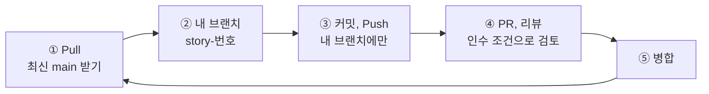
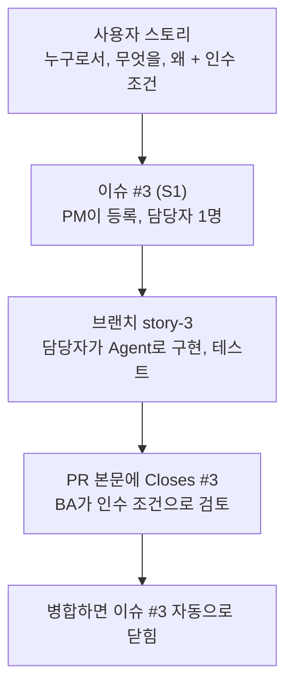
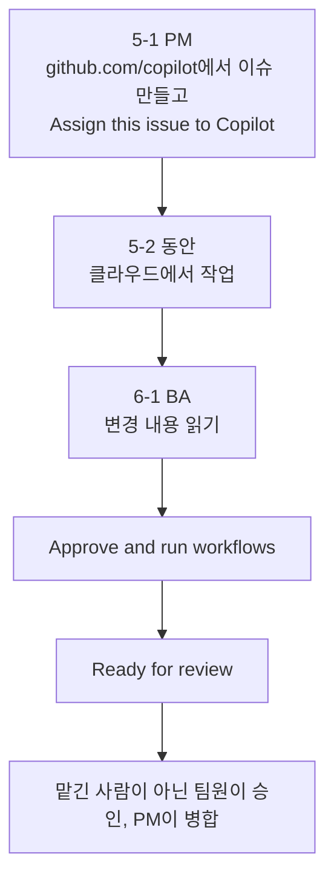
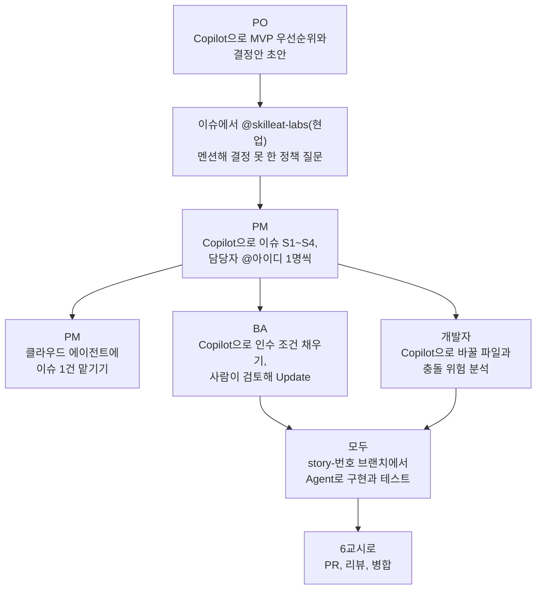

# 5교시. 팀 실습 ① 요구에서 구현까지

!!! abstract "교육 목표"
    역할에 따라 Copilot으로 요구를 정리하고 나눠 각자 기능을 구현할 수 있다.

**이론** 10분  **실습** 40분 (미션 5-0 8분, 미션 5-1 13분, 미션 5-2 19분)  **실습 장소** 팀 리포지토리 `room-booking-team<번호>`

## 시간표 {#timetable}

| 시간 | 무엇을 | 페이지 |
|---|---|---|
| 10분 | 팀 리포지토리를 만드는 방법, 협업 순서, 역할 카드, 팀 백로그 설명 | 이 페이지 |
| 8분 | 미션 5-0 팀 리포지토리 만들기 | [미션 5-0](mission-0.md) |
| 13분 | 미션 5-1 요구 정리와 분배, 클라우드 에이전트에 이슈 맡기기 | [미션 5-1](mission-1.md) |
| 19분 | 미션 5-2 스토리 구현 (그동안 클라우드 에이전트도 일함) | [미션 5-2](mission-2.md) |

## 교안 {#lecture}

!!! question "이번 교시를 시작하며"
    - **왜 지금 하나요?** 오전에는 혼자서 브랜치, `/plan`, Agent 구현, 검토, 테스트, PR까지 해 봤습니다. 실제 일은 여럿이 같은 리포지토리에서 합니다. 누가 무엇을 결정하고, 일을 어떻게 나누고, 어디서 부딪히는지를 팀으로 겪어 봅니다.
    - **앞에서 만든 무엇을 쓰나요?** 미션 5-0에서 PO가 만드는 팀 리포지토리와 그 안의 `docs/` 폴더(현업 요청, 킥오프 회의록, 현행 업무), 3교시에 배운 사용자 스토리와 인수 조건, 4교시의 구현 흐름을 그대로 씁니다.
    - **끝나면 무엇을 넘기나요?** 이슈 S1~S4(인수 조건 포함)와, 각자 자기 브랜치 `story-<번호>`에 커밋된 구현을 6교시에 넘깁니다. 6교시에 PR을 열고 리뷰하고 병합합니다.

### 팀 리포지토리를 만드는 세 가지 방법 {#repo-ways}

| 방법 | 어떻게 | 결과 | 언제 쓰나 |
|---|---|---|---|
| **템플릿** | **Use this template** → **Create a new repository** | 원본과 연결 없는 새 리포. 커밋 기록이 처음부터 시작 | 새 프로젝트를 시작할 때. **오늘 팀 리포** |
| **포크** | **Fork** | 원본과 연결된 내 사본. 고친 뒤 원본에 PR로 기여하고, **Sync fork**로 원본을 따라감 | 쓰기 권한이 없는 리포에 기여할 때(오픈소스) |
| **협업자 초대** | **Settings** → **Collaborators** → **Add people** | 같은 리포에 여러 사람이 직접 push | 팀이 한 리포를 같이 운영할 때. **오늘 팀원** |

오늘 팀은 템플릿과 초대를 같이 씁니다. PO가 Starter 템플릿으로 팀 리포를 만들고 팀원을 협업자로 초대합니다. 템플릿으로 새로 만들었으니 오전에 각자 고친 코드와 지침 파일은 따라오지 않습니다. 그래서 PO가 팀 지침 파일부터 넣고(5-0), 오전에 해 본 겹침 검사를 팀에서 다시 구현합니다. 회사에서는 개인 리포 대신 조직(Organization)을 만들고 팀 단위로 권한을 줍니다.

### 팀이 한 리포지토리를 계속 끌고 가는 법 {#team-loop}



- **규칙:** main에는 직접 push하지 않습니다. 모든 변경은 브랜치와 PR로 합니다.
- **시작 전:** 일을 시작할 때마다 main에서 Pull합니다(VS Code의 **Sync Changes**). 오래된 main에서 갈라지면 나중에 충돌이 커집니다. 6교시에 실제로 충돌을 만나 봅니다.
- **회사에서는:** 이 규칙을 사람에게 맡기지 않고 **main 보호**로 걸어 둡니다. **Settings** → **Rules** → **Rulesets**에서 PR 없이는 병합할 수 없고, 한 명 이상 승인해야 병합되게 합니다.

### 사용자 스토리가 이슈가 되고, PR로 닫힙니다 {#story-issue}

3교시에 쓴 사용자 스토리가 오후에는 일의 단위가 됩니다. **스토리, 즉 요구사항 한 건이 GitHub 이슈 하나**이고, 이슈 하나를 한 사람이 맡아 PR 하나로 끝냅니다.

!!! info "스토리는 회사마다 부르는 이름이 다릅니다"
    애자일, 스크럼으로 일하는 개발팀은 **사용자 스토리**, 줄여서 **스토리**라고 부릅니다. Jira 같은 도구에도 이슈 종류로 "Story"가 있습니다. 전통적인 방식이나 비개발 부서에서는 **요구사항**, **기능**, **과제**, **티켓**, **건**이라고 더 많이 부릅니다. 오늘 말하는 "스토리"는 **요구사항 한 건**이라고 생각하면 됩니다.



이슈 본문은 이런 모양입니다.

```text
제목: S1 겹치는 예약 막기

## 스토리
회의실을 예약하는 직원으로서, 이미 예약된 시간에는 예약이 안 되기를 원한다.
회의실 앞에서 누가 먼저 예약했는지 다투지 않기 위해서이다.

## 바꿀 곳
booking/rules.py

## 인수 조건
- 10:00-11:00 예약이 있으면 10:30-11:30은 "이미 예약된 시간"으로 실패
- 11:00-12:00은 성공 (끝과 시작이 맞닿는 것은 겹침이 아님)
```

인수 조건은 BA가 Copilot으로 초안을 만들고 사람이 확정합니다. 이 인수 조건이 6교시 PR 검토의 기준이 됩니다. 이슈가 모두 스토리는 아닙니다. 6-3의 변경 요청(CR-001)이나 5-3에서 클라우드 에이전트에게 맡기는 작업도 이슈로 만듭니다.

### github.com의 Copilot: 이슈를 쓰고, 고치고, 맡깁니다 {#cloud-agent}

오후에는 VS Code 말고 **github.com의 Copilot**(`github.com/copilot`)도 씁니다. 이슈처럼 정해진 형식을 반복하는 일은 Copilot에게 맡기고, 사람은 무엇을 만들지 정하고 초안을 검토합니다.

| 단계 | 누가 | 무엇을 | 언제 |
|---|---|---|---|
| ① 이슈 초안 만들기 | PM | S1~S4 이슈의 제목, 본문, 라벨, 담당자 초안 → 검토 후 **Create** | 5-1 STEP 3 |
| ② 이슈 고치기 | BA | 이슈를 `#번호`로 불러 인수 조건 채우기 → 검토 후 **Update** | 5-1 STEP 5 |
| ③ 이슈를 Copilot에게 맡기기 | PM | "Assign this issue to Copilot." → **클라우드 에이전트**가 GitHub에서 작업하고 PR을 엶 | 5-1 STEP 4 |

**부르는 법**: 리포지토리는 `아이디/리포 이름`, 이슈와 PR은 `#번호`, 사람은 `@아이디`로 부릅니다.

**클라우드 에이전트**는 이슈를 맡으면 클라우드 환경에서 작업하고, 끝나면 PR을 엽니다. 내 컴퓨터를 꺼도 일합니다. 그래서 5-1에서 일찍 맡기면 팀이 5-2에서 각자 구현하는 동안 Copilot도 같이 일하고, 6-1에서 그 PR을 BA가 검토합니다. AI Credits와 Actions 사용 시간을 함께 쓰니 팀당 한 건만 맡깁니다.



### 5교시 흐름 {#flow}



### 모두 Copilot으로 구현합니다 {#everyone-builds}

이 과정의 역할극은 GitHub 기초 과정과 다릅니다. **역할이 무엇이든 모두 스토리 하나씩을 Copilot으로 구현합니다.** 역할은 그 위에 얹는 책임입니다.

| 질문 | 누가 |
|---|---|
| 무엇부터 할지, 정책을 어떻게 할지 **결정**하나요? | PO |
| 이슈, 담당자, 병합 순서를 **정리**하나요? | PM |
| 다 됐는지를 인수 조건으로 **검토**하나요? | BA |
| 바꿀 파일과 충돌, 기술 위험을 **분석**하나요? | 개발자 |

!!! tip "Copilot은 초안, 사람은 결정"
    오늘 오후에 Copilot은 결정안 초안, 인수 조건 초안, 영향 분석, 코드, 테스트, 리뷰 댓글을 만듭니다. 그것을 **받아들일지 정하는 것은 사람**입니다. 특히 회의록에 없는 정책은 Copilot이 정하지 않습니다. 현업(오늘은 강사)에게 묻습니다.

### 팀 백로그 {#backlog}

현업 요청과 킥오프 회의록의 "결정한 것"에서 나온 스토리 4개입니다. **3인 팀은 S4를 뺍니다.**

| 번호 | 스토리 | 바꿀 곳 | 완료 기준(인수 조건 예) |
|---|---|---|---|
| S1 | 같은 회의실, 같은 날짜에 시간이 겹치는 예약을 막는다 | `booking/rules.py` | 10:00~11:00이 있으면 10:30~11:30은 "이미 예약된 시간"으로 실패. 11:00~12:00은 성공(맞닿음은 겹침 아님) |
| S2 | 회의실 정원을 넘는 예약을 막는다 | `booking/rules.py` | 소회의실 A(정원 4)에 5명이면 "정원을 넘었습니다"로 실패 |
| S3 | 예약을 취소할 수 있다 | `booking/service.py`, `booking/__main__.py` | `python -m booking cancel --id 3`이면 #3이 목록에서 사라지고 "[취소 완료]" 출력. 없는 번호면 "[취소 실패] 없는 예약 번호입니다" |
| S4 | 18:00에 끝나는 예약이 되게 고친다 | `booking/rules.py` | 17:00~18:00 성공, 17:30~18:30 실패 |

!!! warning "S1, S2, S4는 같은 파일을 고칩니다"
    세 사람이 동시에 `booking/rules.py`와 `tests/test_rules.py`를 고치면 6교시 병합 때 **충돌**이 날 수 있습니다. 실제 일에서도 자주 생기는 일이라 일부러 그대로 둡니다. 5-1에서 개발자가 이 위험을 미리 찾고, 6-1에서 충돌을 Copilot과 함께 해결합니다.

S1과 S4는 오전에 개인 리포지토리에서 해 본 것입니다. 해 본 사람이 맡으면 빠르고, 처음 하는 S2, S3도 같은 흐름이라 막히지 않습니다.

## 역할 카드 {#role-cards}

### 역할 한눈에 보기 {#roles}

| 약자 | 풀네임 | 우리말 | 맡는 일 | 직접 고치는 코드 (Copilot과 함께) |
|---|---|---|---|---|
| **PO** | Product Owner | 제품 책임자 | 무엇을, 왜 만들지와 정책을 결정 | 내 스토리(5-2), 변경 요청 CR-001(6-3) |
| **PM** | Project Manager | 프로젝트 관리자 | 언제, 누가 할지 정리하고 병합을 관리 | 내 스토리(5-2), 팀 규칙 더하기(7-3) |
| **BA** | Business Analyst | 업무 분석가 | 무엇이 되어야 다 된 것인지(인수 조건) 정하고 검토 | 내 스토리(5-2) |
| **개발자** | Developer | 개발 담당 | 바꿀 파일과 기술 위험을 보고, 코드를 기술적으로 검토 | 내 스토리(5-2), 배포 워크플로(6-2) |

코드는 개발자만 고치지 않습니다. **모두가 Copilot에게 시켜서** 코드를 고치고, 역할은 그 밖에 누가 결정하고 정리하고 검토하는지를 나눈 것입니다. 7-1 보안 수정과 7-2 자동화 도구도 모두 각자 합니다.


미션을 시작하기 전에 내 역할 카드를 읽습니다. **3인 팀은 BA가 PM 카드도 함께 맡습니다.** 모든 역할은 카드의 일과 별도로 **스토리 하나를 구현**합니다.

=== "PO"

    **풀네임**: Product Owner

    **한 줄 정의**: 제품 책임자. **무엇을, 왜** 만들지 정하고 정책을 최종 결정합니다.

    **하는 일**

    - 결정 4개 중 MVP 우선순위를 정합니다. (5-1)
    - 결정 못 한 정책 3개의 결정안을 만들고, 이슈에서 `@skilleat-labs`(현업 역할 강사)를 멘션해 묻고, 답을 이슈에 남깁니다. (5-1)
    - 6-3 변경 요청 CR-001을 이슈로 등록하고, Copilot Agent로 직접 구현합니다.

    **Copilot에게 시킬 일 (예시)**

    ```text
    #codebase docs/01_킥오프_회의록.md의 "결정한 것" 4개를 MVP 우선순위로 정리하고, "결정하지 못한 것" 3개에 대해 PO 결정안 초안과 현업에게 물어볼 질문을 만들어 주세요.
    ```

    **받는 것과 넘기는 것**

    | 받는 것 | 누구에게서 | 넘기는 것 | 누구에게 |
    |---|---|---|---|
    | 현업 요청, 회의록 | `docs/` 폴더 | 우선순위, 정책 결정 댓글 | 팀 전체 |
    | 정책 답변 | 강사(현업) | 결정 기록 | PM, BA |

=== "PM"

    **풀네임**: Project Manager

    **한 줄 정의**: 프로젝트 관리자. **언제, 누가** 할지 정리하고 병합을 관리합니다.

    **하는 일**

    - 라벨 `스토리`를 만들고, github.com의 Copilot에게 이슈 S1~S4 초안을 맡겨 검토 후 등록합니다. 담당자는 `@아이디`로 정합니다. (5-1)
    - 이슈마다 담당자(Assignees)를 1명씩 정합니다. 전원이 하나씩입니다. (5-1)
    - 6교시에 개발자의 "이견 없음" 멘션을 받으면 짝 승인과 CI 초록을 최종 확인하고 PR을 순서대로 병합합니다. 개발자 PR은 2차 리뷰도 겸합니다. (6-1)
    - 스토리 이슈를 만든 뒤 같은 채팅에서 클라우드 에이전트에게 맡길 이슈를 하나 더 만들어 맡깁니다. (5-1)

    **Copilot에게 시킬 일 (예시)**

    ```text
    In <PO아이디>/room-booking-team<번호>, 팀 백로그 S1~S4로 이슈를 하나씩 만들어 주세요. 본문은 스토리, 바꿀 곳, 완료 기준, 인수 조건 칸으로 쓰고, 라벨은 스토리, 담당자는 @아이디1~@아이디4로 해 주세요. (github.com/copilot에서)
    ```

    **받는 것과 넘기는 것**

    | 받는 것 | 누구에게서 | 넘기는 것 | 누구에게 |
    |---|---|---|---|
    | 우선순위 | PO | 이슈 S1~S4, 담당자 | 팀 전체 |
    | 짝이 승인한 PR | 팀원 | 병합 결과 | 팀 전체 |

=== "BA"

    **풀네임**: Business Analyst

    **한 줄 정의**: 업무 분석가. **구체적으로** 무엇이 되어야 다 된 것인지 정하고 검토합니다.

    **하는 일**

    - github.com의 Copilot에게 이슈를 `#번호`로 불러 인수 조건(Given-When-Then: 이런 상황에서, 이렇게 하면, 이렇게 된다)을 채우게 하고, 직접 검토해 **Update**합니다. (5-1)
    - 6교시에 리뷰할 때 인수 조건이 애매하면 기준을 알려 줍니다. 리뷰 자체는 모두가 짝의 PR을 하나씩 맡습니다. (6-1)
    - 6-3에서 CR-001 영향 분석을 합니다.

    **Copilot에게 시킬 일 (예시)**

    ```text
    In <PO아이디>/room-booking-team<번호>, update issues #2, #3, #4, #5. 각 이슈의 "## 인수 조건"을 Given-When-Then 형식 3개(정상, 실패, 경계값)로 채워 주세요. 문서에 없는 정책은 "확인 필요"로 표시해 주세요. (github.com/copilot에서)
    ```

    **받는 것과 넘기는 것**

    | 받는 것 | 누구에게서 | 넘기는 것 | 누구에게 |
    |---|---|---|---|
    | 이슈 S1~S4 | PM | 인수 조건 | 담당자 전원 |
    | 인수 조건 질문 | 리뷰하는 팀원 | 기준 설명 | 리뷰하는 팀원 |

=== "개발자"

    **풀네임**: Developer

    **한 줄 정의**: 기술 담당. 바꿀 파일과 **기술 위험**을 미리 보고 팀을 돕습니다.

    **하는 일**

    - 스토리마다 바꿀 파일과 충돌 위험을 Copilot으로 분석해 이슈 댓글로 남깁니다. (5-1)
    - 팀원이 구현하다 막히면 함께 봅니다. (5-2)
    - 6-1에서 모든 스토리 PR을 2차 기술 리뷰합니다. github.com Copilot에 PR을 `#번호`로 불러 도움을 받고, "이견 있음/없음" 댓글을 남기고, 이견이 없으면 `@PM`을 멘션합니다.
    - 6-2에서 배포 워크플로를 Copilot으로 만들고, 6-3에서 PO가 구현한 CR-001을 기술적으로 검토합니다.

    **Copilot에게 시킬 일 (예시)**

    ```text
    #codebase 스토리 S1~S4를 구현하면 각각 어떤 파일의 어떤 함수가 바뀌는지 표로 정리하고, 같은 파일을 동시에 고쳐 병합 충돌이 날 위험이 있는 조합을 알려 주세요.
    ```

    **받는 것과 넘기는 것**

    | 받는 것 | 누구에게서 | 넘기는 것 | 누구에게 |
    |---|---|---|---|
    | 이슈 S1~S4 | PM | 바꿀 파일, 충돌 위험 댓글 | 팀 전체, PM |
    | 병합된 main | PM | 배포 워크플로 | 팀 전체 |

## 크레딧 아껴 쓰기 {#credits}

- 모델은 **Copilot Fusion**(Standard)으로 둡니다. 2026-11-30까지 모델 비용이 30% 할인됩니다.
- Chat과 Agent는 AI Credits를 씁니다. 같은 질문을 여러 번 다시 보내지 말고, 답을 고쳐 달라고 이어서 요청합니다.
- 6교시 Copilot 코드 리뷰(1회 약 150크레딧, Balanced 기준)는 **각자 자기 PR에 1회만** 합니다.
- 7교시 클라우드 에이전트는 **팀당 1건만** 맡깁니다.

## 이번 교시 정리 {#summary}

- 역할은 결정(PO), 정리(PM), 검토(BA), 분석(개발자)이고, 구현은 모두가 Copilot으로 합니다.
- Copilot의 초안은 사람이 검토해 이슈에 남깁니다. 문서에 없는 정책은 현업에게 묻습니다.
- S1, S2, S4는 같은 파일을 고쳐 충돌이 날 수 있습니다. 6교시에 해결합니다.
