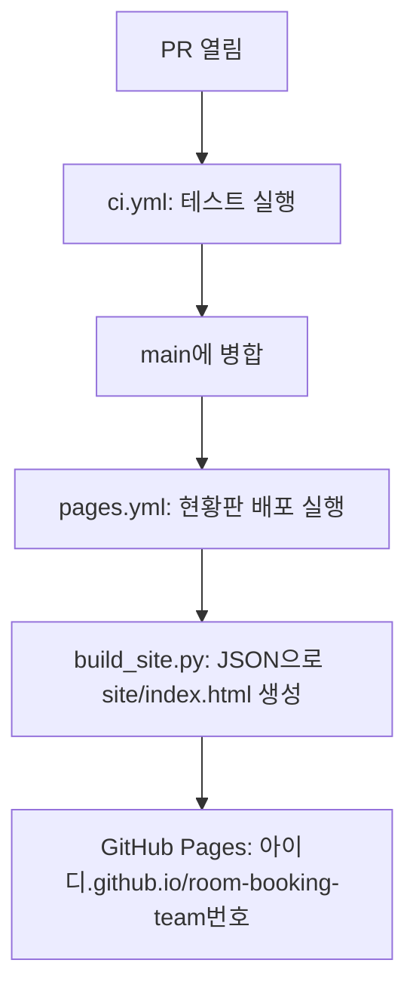

# 6교시. 팀 실습 ② 검토와 CI/CD

!!! abstract "이번 교시의 목표"
    Copilot 코드 리뷰와 사람 검토로 변경을 반영하고, Copilot으로 배포 워크플로를 만들어 현황판을 자동 배포할 수 있습니다.

| 구간 | 시간 |
|---|---|
| 이론 | 15분 |
| 미션 6-1 | 14분 |
| 미션 6-2 | 11분 |
| 미션 6-3 | 10분 |

실습 페이지:

- [미션 6-1 PR과 리뷰](mission-1.md)
- [미션 6-2 배포 자동화](mission-2.md)
- [미션 6-3 변경 요청 처리](mission-3.md)

## 교안 { #lecture }

### Copilot 코드 리뷰는 의견일 뿐, 승인은 사람이 합니다

PR을 열면 Reviewers에서 Copilot에게 리뷰를 요청할 수 있어요. Copilot은 코드의 문제나 개선점을 댓글로 남겨요. 승인이나 반려를 하는 게 아니라 댓글형 리뷰예요. 한 번에 평균 150 크레딧 정도 들어서 오늘은 자기 PR에 한 번만 요청해요. 그리고 Copilot 댓글을 받아들일지는 사람이 판단해요. 정말 중요한 건 사람 리뷰예요. 오늘은 BA 한 명이 다 보지 않고 짝 리뷰를 해요. S1 담당이 S2를, S2가 S3를 보는 식으로 돌아가요. 먼저 나를 리뷰할 짝에게 1분 동안 Copilot에게 어떻게 시켰고 무엇이 바뀌었고 어떻게 확인했는지 설명해요. 같은 스토리라도 사람마다 방법이 달라서 서로 배울 게 많아요. 짝은 이슈의 인수 조건으로 확인하고 Approve하고, PM이 짝 승인과 테스트 초록을 최종 확인해서 병합해요. 인수 조건이 애매하면 BA에게 물어요.

### 겹침 검사와 정원 검사가 충돌하면 두 기능을 모두 살립니다

```text
<<<<<<< story-5
    # 정원 검사 (S2)
=======
    # 겹침 검사 (S1)
>>>>>>> main
```

이번 경우는 두 검사를 모두 남기고 표시 줄을 지웁니다.

같은 파일이라도 다른 줄을 고치면 Git이 보통 자동으로 합쳐요. 충돌은 같은 줄을 서로 다르게 고쳤을 때 나요. S1 겹침 검사와 S2 정원 검사는 둘 다 rules.py의 같은 자리에 코드를 넣기 쉬워서, 한 PR이 먼저 병합되면 다음 PR에 충돌이 날 수 있어요. 충돌 표시는 이렇게 생겼어요. 위가 내 브랜치, 아래가 main의 내용이에요. 해결은 합친 뒤 최종 내용을 정하는 일이에요. 이 사례는 두 기능이 다 필요하니 두 검사를 모두 남겨요. 표시 줄을 지운 뒤 중복된 변수나 흐름이 없는지 보고 테스트로 확인해요. 항상 양쪽을 남기는 건 아니에요. 헷갈리면 충돌 부분을 Copilot에게 붙여서 설명을 받아요. 하지만 무엇을 남길지는 우리가 정해요.

### CI는 이미 있고, CD는 Copilot으로 만듭니다



CI/CD 전체 그림이에요. PR이 열리면 ci.yml이 테스트를 돌려요. 이건 Starter에 이미 있어요. 병합되면 pages.yml이 돌아서 build_site.py로 예약 현황판 웹페이지를 만들고, GitHub Pages로 배포해요. 이 pages.yml이 아직 없어요. 미션 6-2에서 Copilot에게 만들게 할 거예요. Actions 문법을 몰라도 돼요. 대신 아래 [배포 워크플로 검토 기준](#workflow-check)으로 확인해요. 하나 더, S1에서 S4는 예약 명령의 동작을 바꾸는 기능이라 병합해도 현황판 내용은 그대로예요. 현황판은 저장된 JSON을 보여 주니까요. 6-3의 CR-001은 화면을 바꾸는 작업이라 그때 현황판이 달라져요.

### Copilot이 만든 배포 워크플로는 다섯 곳을 확인합니다 { #workflow-check }

| 확인 | 찾을 내용 |
|---|---|
| ① 언제 | `on:` 아래 `push: branches: [main]`, `workflow_dispatch:` |
| ② 권한 | `contents: read`, `pages: write`, `id-token: write` |
| ③ 환경 | `environment:` 아래 `name: github-pages` |
| ④ 만들기 | `actions/checkout`, `actions/setup-python`, `python build_site.py` |
| ⑤ 올리고 배포 | `actions/upload-pages-artifact`(`path: site`), `actions/deploy-pages` |

Settings의 Pages Source는 GitHub Actions여야 합니다. 자세한 검토표는 [미션 6-2](mission-2.md)에 있습니다.

Copilot이 만든 워크플로는 이 다섯 곳을 확인해요. 언제 실행되는지, main에 push될 때와 손으로 실행할 때. 권한에 contents read, pages write, id-token write가 있는지. 배포 환경 environment github-pages가 있는지예요. GitHub 문서가 요구하는 항목이라 빠지면 안 돼요. 코드를 받아 Python을 준비하고 build_site.py를 실행하는지. 만든 site 폴더를 올리고 deploy-pages로 배포하는지예요. 리포지토리 Settings의 Pages에서 Source가 GitHub Actions로 되어 있어야 해요. 이건 5교시 팀 리포를 만들 때 PO가 미리 바꿔 뒀어요. 가이드에 강사 참고 정답도 접어 두었으니 비교해 보세요.

### 변경 요청이 오면 Copilot으로 영향부터 찾습니다

!!! quote "현업의 변경 요청 CR-001"
    현황판이 회의실 앞 태블릿과 사외에서도 보입니다. 연락처는 빼고, 예약자는 성과 '○○'로만 보여 주세요. 예: 김○○

미션 마지막에 현업에서 변경 요청이 하나 들어와요. 현황판이 사외에서도 보이니 연락처를 빼고 예약자 이름은 성만 보여 달라는 거예요. 회의록에서 결정 못 한 '연락처 공개'가 결국 이렇게 정리된 거죠. PO가 이슈로 접수하고, BA가 #codebase로 어디가 바뀌어야 하는지 영향 분석을 해요. 데이터는 그대로 두고 화면을 만드는 build_site.py만 바뀌면 된다는 걸 Copilot과 함께 확인해요. PO가 Copilot으로 직접 구현하고 개발자가 기술 검토해서 병합하면, 방금 만든 CD 덕분에 현황판이 자동으로 바뀌어요. 다만 화면에서 가렸을 뿐이에요. 오늘 실습은 가짜 데이터라 괜찮지만, Public 리포지토리의 JSON 원본은 그대로 공개돼 있어요. 실제 업무라면 개인정보를 Public 리포지토리에 두면 안 돼요.

## 실습

- [미션 6-1 PR과 리뷰](mission-1.md)
- [미션 6-2 배포 자동화](mission-2.md)
- [미션 6-3 변경 요청 처리](mission-3.md)
