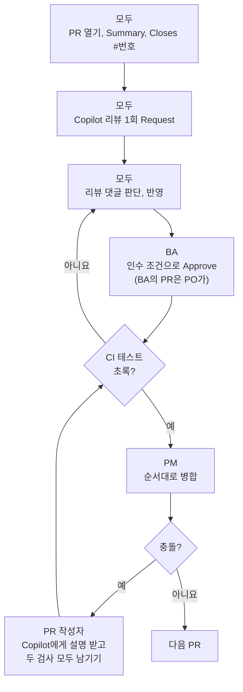

# 미션 6-1. PR과 리뷰

!!! abstract "이 미션에서 할 일"
    - 각자 자기 스토리 브랜치로 PR을 열고, Copilot **Summary**로 설명을 쓰고, Copilot 코드 리뷰를 **1회** 요청합니다.
    - Copilot 리뷰 댓글을 사람이 판단해 반영하고, BA가 인수 조건으로 승인합니다.
    - PM이 CI "테스트"가 초록인 PR을 순서대로 병합합니다. 충돌이 나면 Copilot의 설명을 받아 두 검사를 모두 남기도록 해결합니다.

**소요 시간** 약 14분  **실습 장소** 팀 리포지토리 `room-booking-team<번호>` (github.com, VS Code)  **관련 교안** [6교시 교안](index.md)

## 준비

- 교시 시작에 github.com의 브랜치 목록에서 모든 팀원의 `story-<번호>` 브랜치가 올라와 있는지 함께 확인합니다.
- 이 페이지는 S1 이슈 `#3`, 브랜치 `story-3`을 예로 씁니다. 내 번호로 바꿔 읽습니다.

## 전체 흐름



## STEP 1. (모두) PR 열기

1. github.com 팀 리포지토리를 엽니다.
2. 노란 띠 **story-3 had recent pushes** → **Compare & pull request**를 클릭합니다. 띠가 없으면 **Pull requests** → **New pull request** → **compare**를 내 브랜치로 고릅니다.
3. `base: main` ← `compare: story-<내번호>`인지 봅니다.
4. 제목을 입력합니다. 내 스토리에 맞게 바꿉니다.

    ```text
    [S1] 겹치는 예약 막기 (#3)
    ```

5. 설명 칸 도구 모음의 Copilot 아이콘 → **Summary**를 클릭합니다.
6. 요약을 빠르게 읽고 하지 않은 일이 적혀 있으면 고칩니다. 오래 다듬지 않습니다.
7. 맨 아래에 직접 확인 결과와 이슈 연결 줄을 덧붙입니다.

    ```text
    직접 확인: 10:30~11:30 실패, 11:00~12:00 성공

    Closes #3
    ```

8. **Create pull request**를 클릭합니다.

확인: PR 설명에 `Closes #3`이 있고, 아래 검사 영역에서 **테스트 / test**가 돌기 시작했습니다.

!!! note "화면이 조금 다를 수 있어요"
    PR 설명의 Copilot 메뉴와 **Summary**는 공식 문서 검색 요약으로 확인한 이름입니다. 아이콘이 안 보이면 PR을 만든 뒤 설명 편집 화면에서 찾습니다.

!!! tip "Closes #번호"
    PR 설명에 `Closes #3`이 있으면 이 PR이 병합될 때 이슈 #3이 자동으로 닫힙니다.

## STEP 2. (모두) Copilot 코드 리뷰 요청하기

!!! warning "자기 PR에 1회만 합니다"
    Copilot 코드 리뷰는 AI Credits와 Actions 사용 시간을 씁니다. 1회 약 150크레딧(Balanced 기준)입니다. 월 1,500크레딧 중 10%입니다. **각자 자기 PR에 1회만** 요청합니다. 다른 사람 PR에는 요청하지 않습니다.

1. PR 오른쪽 **Reviewers**(검토자)를 봅니다.
2. **Copilot** 옆 **Request**(요청)를 클릭합니다. 목록에 없으면 톱니를 눌러 **Copilot**을 고릅니다.
3. 같은 **Reviewers** 톱니에서 BA를 고릅니다. 내가 BA라면 PO를 고릅니다.
4. 몇 분 기다리면 **Conversation** 탭에 Copilot의 리뷰와 줄별 댓글이 달립니다.

확인: **Reviewers**에 Copilot과 BA(또는 PO)가 있고, Copilot 리뷰가 도착했습니다.

!!! note "화면이 조금 다를 수 있어요"
    Copilot 리뷰 요청 버튼의 위치와 이름은 공식 문서 검색 요약으로 확인한 것입니다.

## STEP 3. (모두) Copilot 리뷰 댓글 판단하기

Copilot 리뷰는 **댓글형**입니다. 승인(Approve)이나 변경 요청(Request changes)이 아니라 의견을 남기는 것입니다. 반영할지는 사람이 정합니다.

1. Copilot 댓글을 하나씩 읽고 아래 기준으로 판단합니다.

    | 댓글 예 | 판단 |
    |---|---|
    | 인수 조건의 경계값 테스트가 빠졌다 | 반영 |
    | 오류 메시지에 예약 번호를 넣으면 좋겠다 | 인수 조건과 맞으면 반영 |
    | 최대 예약 시간 검사도 넣자 | 반영하지 않음. 이번 스토리 범위가 아님 |
    | 변수 이름을 바꾸자 | 선택. 시간이 있으면 |

2. 반영하지 않는 댓글에는 이유를 답글로 남깁니다.

    ```text
    이번 스토리 범위가 아니라 반영하지 않습니다. (회의록 "결정하지 못한 것")
    ```

3. 반영할 댓글이 있으면 VS Code에서 내 브랜치(`story-<내번호>`)인지 확인하고, 댓글 내용을 Chat(Agent)에 붙여 넣습니다.

    ```text
    PR 리뷰에서 아래 의견을 받았습니다. 반영해 주세요. 다른 곳은 바꾸지 마세요. 다 되면 python -m pytest를 실행해 주세요.
    (여기에 리뷰 댓글)
    ```

4. 검토하고 커밋한 뒤 **Sync Changes**로 올립니다. PR에 커밋이 추가되고 CI가 다시 돕니다.
5. 반영한 댓글에는 "반영했습니다"라고 답하고 **Resolve conversation**을 클릭합니다.

확인: 모든 Copilot 댓글에 반영 또는 미반영 답글이 있습니다.

## STEP 4. (BA) 인수 조건으로 사람 리뷰하기

BA는 팀원 PR을 하나씩 검토합니다. BA 자신의 PR은 PO가 같은 방법으로 검토합니다.

1. **Pull requests** 탭에서 PR을 엽니다.
2. 연결된 이슈의 인수 조건을 옆 탭에 열어 둡니다.
3. **Files changed** 탭에서 테스트 파일을 열고, 인수 조건마다 테스트가 있는지 봅니다.
4. PR 설명의 "직접 확인" 줄이 인수 조건과 같은지 봅니다.
5. **Checks**에서 **테스트 / test**가 초록인지 봅니다.
6. 오른쪽 위 **Review changes**(화면에 따라 **Submit review**)를 클릭합니다.
7. 의견을 쓰고 **Approve**를 고른 뒤 **Submit review**를 클릭합니다.

    ```text
    인수 조건 3개 모두 테스트가 있고, 직접 확인 결과도 인수 조건과 같습니다. 승인합니다.
    ```

    빠진 것이 있으면 **Request changes**를 고르고 무엇이 빠졌는지 씁니다.

8. PM에게 "#3 승인했습니다"라고 알립니다.

확인: PR에 `<BA아이디> approved these changes`가 보입니다.

## STEP 5. (PM) 순서대로 병합하기

5-1에서 개발자가 추천한 순서를 씁니다. 추천이 없으면 충돌이 없는 S3부터, 그다음 S4, S1, S2 순서로 합니다.

1. PR을 열고 아래 세 가지를 확인합니다.
    - **테스트 / test**가 초록 체크
    - BA(또는 PO)의 Approve
    - 충돌 없음 (**This branch has no conflicts with the base branch**)
2. **Merge pull request** → **Confirm merge**를 클릭합니다.
3. **Delete branch**를 클릭합니다.
4. 연결된 이슈가 **Closed**가 됐는지 봅니다.
5. 다음 PR로 넘어갑니다.

확인: 병합한 PR이 보라색 **Merged**이고, 이슈가 닫혔습니다.

## STEP 6. 충돌이 나면 해결하기

S1, S2, S4는 모두 `booking/rules.py`와 `tests/test_rules.py`를 고쳤습니다. 먼저 하나가 병합되면 나머지 PR에 **This branch has conflicts that must be resolved**가 뜰 수 있습니다. 충돌은 **PR 작성자**가 풀고, 개발자가 돕습니다.

=== "github.com에서"

    1. PR 아래쪽 **Resolve conflicts**(충돌 해결)를 클릭합니다.
    2. 편집기에 아래처럼 표시된 부분을 찾습니다.

        ```text
        <<<<<<< story-3
        (내 브랜치의 코드)
        =======
        (main에 먼저 들어간 코드)
        >>>>>>> main
        ```

    3. 그 부분을 복사해 VS Code Chat(**Ask**)에 붙여 넣습니다.

        ```text
        병합 충돌입니다. 위쪽은 내 브랜치(겹침 검사), 아래쪽은 main에 먼저 들어간 변경입니다.
        각각 무엇을 하는 코드인지 설명하고, 두 검사가 모두 남도록 합친 코드를 보여 주세요. 충돌 표시 줄(<<<, ===, >>>)은 빼 주세요.
        (여기에 충돌 부분)
        ```

    4. 답을 읽고, **두 검사가 모두 남는지** 확인한 뒤 편집기의 충돌 부분을 합친 코드로 바꿉니다. `<<<<<<<`, `=======`, `>>>>>>>` 줄이 남지 않게 합니다.
    5. 파일마다 **Mark as resolved**(해결됨으로 표시)를 클릭합니다.
    6. **Commit merge**(병합 커밋)를 클릭합니다.

=== "VS Code에서"

    github.com에 **Resolve conflicts** 버튼이 없으면 이 방법을 씁니다.

    1. 상태 표시줄 브랜치가 `story-<내번호>`인지 봅니다.
    2. 명령 팔레트(Windows ++ctrl+shift+p++, Mac ++cmd+shift+p++)에서 `Git: Fetch`를 실행합니다.
    3. 명령 팔레트에서 `Git: Merge Branch...`를 실행하고 `origin/main`을 고릅니다.
    4. 소스 제어에 충돌 파일이 나옵니다. 파일을 열고 **Resolve in Merge Editor**(병합 편집기에서 해결)를 클릭합니다.
    5. 충돌 부분을 선택해 Chat(**Ask**)에 위 github.com 탭 3번 프롬프트로 설명을 받습니다.
    6. 병합 편집기에서 양쪽을 모두 받아들이고(두 검사를 모두 남기고) 아래 결과를 확인한 뒤 **Complete Merge**를 클릭합니다.
    7. 커밋하고 **Sync Changes**로 올립니다.

    !!! note "화면이 조금 다를 수 있어요"
        병합 편집기의 버튼 이름은 VS Code 버전에 따라 다를 수 있습니다. 결과 창에 두 검사가 모두 들어 있고 충돌 표시 줄이 없으면 됩니다.

해결한 뒤에는 꼭 테스트로 확인합니다.

1. PR 검사 영역에서 **테스트 / test**가 다시 돌고 초록이 되는지 봅니다.
2. **Details** 로그에서 두 스토리의 필요한 시나리오가 남아 있고 각각 통과했는지 봅니다. 두 브랜치에 같은 기존 테스트가 있으니 개수를 더해 비교하지 않습니다.
3. 초록이면 PM에게 다시 병합을 부탁합니다.

확인: 충돌 표시가 사라졌고, **테스트 / test**가 초록이며, 두 스토리의 시나리오가 모두 `PASSED`입니다.

!!! warning "이번 사례는 두 기능을 모두 살립니다"
    같은 파일이라도 다른 줄을 고쳤으면 보통 자동으로 합쳐집니다. 충돌 해결은 최종 내용을 정하는 일이고, 항상 양쪽을 남기는 것은 아닙니다. 겹침 검사와 정원 검사는 둘 다 필요하므로 모두 남기고, 중복된 변수나 흐름이 없는지도 봅니다. 충돌을 빨리 없애려고 한쪽 코드를 지우면 테스트가 실패하거나, 더 나쁘게는 테스트까지 지워져 기능이 조용히 사라집니다. Copilot이 합친 코드도 그대로 믿지 말고 두 검사가 다 있는지 직접 봅니다.

## 다 됐는지 확인

- [ ] 모두 자기 PR을 열었고 설명에 `Closes #번호`가 있다
- [ ] 각자 자기 PR에 Copilot 리뷰를 1회 요청했고, 댓글마다 반영 여부를 답했다
- [ ] BA(BA의 PR은 PO)가 인수 조건으로 Approve했다
- [ ] PM이 CI 초록인 PR을 모두 병합했고 이슈 S1~S4가 Closed다
- [ ] 충돌이 났다면 두 검사를 모두 남기고 테스트가 통과했다
- [ ] 모두 VS Code에서 main으로 돌아와 동기화했다

## 막히면

??? failure "Reviewers에 Copilot이 없어요"
    Copilot Pro 라이선스가 활성인지 확인합니다. 프로필 사진 → **Copilot settings**에서 플랜을 봅니다. 시간이 없으면 Copilot 리뷰 없이 BA 리뷰만 진행하고 강사에게 알립니다.

??? failure "Copilot 리뷰가 몇 분이 지나도 안 와요"
    Copilot 리뷰는 Actions 사용 시간도 쓰기 때문에 몇 분 걸릴 수 있습니다. 다시 Request하면 크레딧을 또 씁니다. 기다리는 동안 BA 리뷰를 먼저 진행합니다.

??? failure "Approve 선택지가 없어요"
    자기가 연 PR은 승인할 수 없습니다. BA의 PR은 PO가 검토합니다. 또 **Files changed** 탭에 들어가야 **Review changes** 버튼이 보입니다.

??? failure "충돌을 풀었는데 테스트가 실패해요"
    한쪽 검사가 빠졌거나 테스트 함수 이름이 겹쳤을 수 있습니다. **Details** 로그의 실패 줄을 Chat에 붙여 넣고 "충돌을 푼 뒤 이 테스트가 실패합니다. 두 스토리의 검사와 테스트가 모두 남게 고쳐 주세요"라고 요청합니다.

??? failure "병합했는데 이슈가 안 닫혀요"
    PR 설명에 `Closes #번호`가 없었거나 번호가 틀린 것입니다. 이슈를 직접 열어 **Close issue**를 누릅니다.
