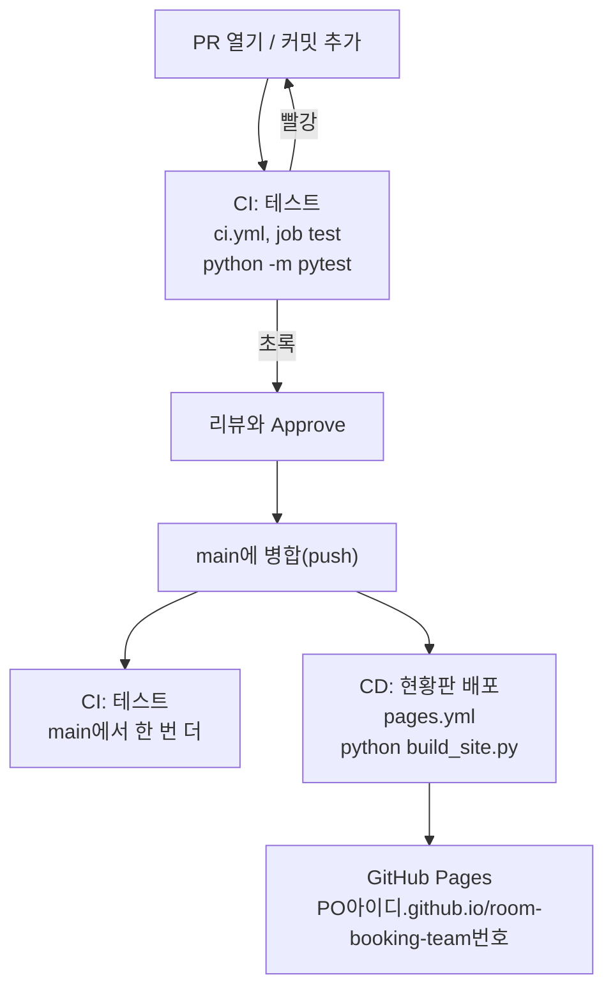

# 미션 6-2. Copilot으로 배포 자동화

!!! abstract "이 미션에서 할 일"
    - 개발자가 브랜치 `add-pages`에서 Copilot Agent에게 배포 워크플로 `.github/workflows/pages.yml`(이름 "현황판 배포")을 만들게 합니다.
    - 팀이 체크리스트로 워크플로를 검토하고, PR로 병합합니다.
    - main에 병합되면 현황판이 GitHub Pages 주소로 자동 배포되는 것을 확인합니다. CI(테스트)와 CD(배포)를 함께 정리합니다.

**소요 시간** 약 11분  **실습 장소** 팀 리포지토리 `room-booking-team<번호>`  **관련 교안** [6교시 교안](index.md)

## 준비

- 미션 6-1에서 스토리 PR이 모두 병합되어 있으면 좋습니다. 덜 끝났어도 이 미션은 시작할 수 있습니다.
- 4-4에서 PO가 **Settings** → **Pages** → Source를 **GitHub Actions**로 바꿔 두었어야 합니다.
- 작업은 **개발자 한 명**이 VS Code에서 하고, 나머지는 화면을 같이 보며 STEP 3 검토를 함께 합니다.

!!! info "예약 명령과 현황판의 관계"
    예약 명령 실행 → 예약 규칙 검사 → JSON에 저장 → `build_site.py`로 HTML 생성 → Pages에 게시. S1~S4는 예약 명령의 동작을 바꾸는 기능이라, 병합해도 현황판에는 데이터의 5건이 그대로 보입니다. 정상입니다. 현황판 웹페이지에서 예약을 입력하는 기능은 이번 과정에서 만들지 않습니다.

!!! info "CD가 뭔가요?"
    CD(Continuous Deployment, 지속적 배포)는 main에 병합될 때마다 결과물을 자동으로 내보내는 것입니다. 우리 팀은 `python build_site.py`로 만든 현황판 `site/index.html`을 GitHub Pages(GitHub가 제공하는 무료 웹페이지 호스팅)에 올립니다. `site/` 폴더는 `.gitignore`에 들어 있어 커밋되지 않습니다. 그래서 GitHub Actions가 서버에서 직접 만들어 올려야 합니다.

## STEP 1. (개발자) 브랜치 `add-pages` 만들기

1. VS Code에서 상태 표시줄 브랜치가 `main`인지 보고, 동기화 아이콘을 눌러 최신으로 맞춥니다.
2. 브랜치 이름 `main` 클릭 → **Create new branch...** → 이름 입력 → ++enter++

    ```text
    add-pages
    ```

확인: 상태 표시줄에 `add-pages`가 보입니다.

## STEP 2. (개발자) Agent에게 워크플로 만들게 하기

1. Chat 보기 **+**(**New Chat**) → Session Target **Copilot**, Agent **Agent**, 모델 **Copilot Fusion**를 고릅니다.
2. **+**(**Add Context**) → **Files & Folders**로 `build_site.py`, `.github/workflows/ci.yml`을 추가합니다.
3. Chat에 붙여 넣기

    ```text
    GitHub Pages 배포 워크플로를 만들어 주세요.
    - 파일: .github/workflows/pages.yml
    - 워크플로 이름: 현황판 배포
    - 실행 시점: main에 push될 때, 그리고 수동 실행(workflow_dispatch)
    - 할 일: Python 3.12로 python build_site.py를 실행해 site/ 폴더를 만들고, site/ 폴더를 GitHub Pages에 배포
    - GitHub 공식 Pages 액션(configure-pages, upload-pages-artifact, deploy-pages)을 써 주세요.
    - 필요한 권한(permissions)만 최소로 주세요.
    - 다른 파일은 바꾸지 마세요.
    - 다 만든 뒤 각 단계가 무엇을 하는지 한 줄씩 설명해 주세요.
    ```

4. 승인 요청이 뜨면 읽고 승인합니다.

확인: `.github/workflows/pages.yml`이 새로 생겼고, 채팅에 단계별 설명이 있습니다.

## STEP 3. (팀 함께) 워크플로 검토하기

Copilot이 만든 워크플로는 매번 조금씩 다릅니다. 순서나 버전 숫자가 달라도, 아래 항목이 모두 있으면 됩니다. `pages.yml`을 열어 하나씩 찾습니다.

| 확인 | 찾을 내용 | 왜 필요한가 |
|---|---|---|
| 이름 | `name: 현황판 배포` | Actions 탭에서 찾는 이름 |
| 실행 시점 | `on:` 아래 `push:`와 `branches: [main]` | main에 병합될 때만 배포 |
| 수동 실행 | `workflow_dispatch:` | 데이터만 바꿨을 때 손으로 다시 배포 |
| 권한 | `contents: read`, `pages: write`, `id-token: write` | 코드를 읽고 Pages에 배포하는 데 필요 |
| 배포 환경 | `environment:` 아래 `name: github-pages` | GitHub 문서가 요구하는 항목 |
| 코드 받기 | `actions/checkout` | 저장소 파일을 가져옴 |
| Python 준비 | `actions/setup-python`과 3.12 | `build_site.py` 실행 환경 |
| 사이트 만들기 | `run: python build_site.py` | `site/index.html` 생성 |
| 설정 | `actions/configure-pages` | Pages 배포 준비 |
| 올리기 | `actions/upload-pages-artifact`와 `path: site` | `site/` 폴더를 배포 묶음으로 |
| 배포 | `actions/deploy-pages` | 실제 배포 |

빠진 것이 있으면 Chat에 요청합니다. 예:

```text
permissions에 pages: write와 id-token: write가 없습니다. 추가해 주세요.
```

확인: 표의 항목을 모두 찾았습니다. 버전 숫자나 순서는 달라도 됩니다.

??? example "강사 참고 정답"
    아래는 비교용 참고 워크플로입니다. Copilot 결과와 비교만 하고, 그대로 복사하지 않습니다. `concurrency`(동시에 두 번 배포되지 않게)는 있으면 좋은 항목입니다. 위 표의 항목은 모두 있어야 합니다.

    ```yaml
    name: 현황판 배포

    on:
      push:
        branches: [main]
      workflow_dispatch:

    permissions:
      contents: read
      pages: write
      id-token: write

    concurrency:
      group: pages
      cancel-in-progress: true

    jobs:
      deploy:
        runs-on: ubuntu-latest
        environment:
          name: github-pages
          url: ${{ steps.deployment.outputs.page_url }}
        steps:
          - uses: actions/checkout@v4
          - uses: actions/setup-python@v5
            with:
              python-version: "3.12"
          - run: python build_site.py
          - uses: actions/configure-pages@v5
          - uses: actions/upload-pages-artifact@v4
            with:
              path: site
          - id: deployment
            uses: actions/deploy-pages@v4
    ```

!!! warning "권한은 최소로"
    Copilot이 `contents: write`나 `permissions: write-all`처럼 넓은 권한을 넣었다면 줄여 달라고 요청합니다. 배포에는 `contents: read`, `pages: write`, `id-token: write`면 충분합니다. 워크플로 권한도 Copilot 결과에서 사람이 검토해야 하는 부분입니다.

## STEP 4. (개발자) 커밋하고 PR 열기

1. **소스 제어**에서 바뀐 파일이 `.github/workflows/pages.yml` 하나인지 봅니다.
2. 메시지를 입력하고 **Commit**을 클릭합니다.

    ```text
    현황판 배포 워크플로 추가
    ```

3. **Publish Branch**를 클릭합니다.
4. github.com에서 **Compare & pull request**를 클릭합니다.
5. 제목 `현황판 배포 워크플로 추가`, 설명은 Copilot **Summary**로 만들고 검토합니다.
6. **Create pull request**를 클릭합니다.
7. **테스트 / test**가 초록인지 봅니다. "현황판 배포"는 main에 push될 때만 돌기 때문에 PR에서는 보이지 않는 것이 정상입니다.

확인: PR이 열렸고 **테스트 / test**가 초록입니다.

!!! tip "Copilot 리뷰는 요청하지 않아요"
    6-1에서 각자 1회씩 썼습니다. 이 PR은 팀이 STEP 3에서 함께 검토했으니 BA나 PO가 **Approve**합니다.

## STEP 5. (PM) 병합하고 배포 확인하기

1. BA나 PO의 **Approve**를 확인하고 **Merge pull request** → **Confirm merge**를 클릭합니다.
2. **Delete branch**를 클릭합니다.
3. 위쪽 **Actions** 탭을 클릭합니다.
4. 왼쪽 목록에 **현황판 배포**와 **테스트**가 보입니다. **현황판 배포**를 클릭합니다.
5. 맨 위 실행 기록이 노란 원에서 초록 체크가 될 때까지 1~2분 기다립니다.
6. 실행 기록을 클릭하면 **deploy** 상자 아래에 배포 주소가 보입니다. 클릭합니다.

    ```text
    https://<PO아이디>.github.io/room-booking-team<번호>/
    ```

7. 주소를 팀 모두에게 알립니다.

확인: 노란 표 머리글의 "회의실 예약 현황" 페이지가 열리고, 예약 5건이 보입니다. 6-1에서 S3(취소)를 병합했더라도 데이터 파일은 바꾸지 않았으므로 5건이 그대로입니다.

!!! note "왜 연락처가 보이죠?"
    지금 현황판에는 예약자 연락처가 그대로 공개되어 있습니다. 이 주소는 누구나 열 수 있습니다. 다음 미션 6-3에서 현업이 이 문제를 변경 요청으로 가져옵니다.

## STEP 6. CI와 CD 정리

오늘 팀 리포지토리에는 자동화 두 개가 있습니다.



| 구분 | 워크플로 | 언제 | 무엇을 | 누가 만들었나 |
|---|---|---|---|---|
| CI | `ci.yml` "테스트" | PR, main push | 테스트 자동 실행 | Starter에 들어 있음 |
| CD | `pages.yml` "현황판 배포" | main push, 수동 | 현황판 만들고 배포 | 우리 팀이 Copilot으로 |

확인: 팀원 모두가 CI와 CD의 차이를 한 문장으로 말할 수 있습니다.

## 다 됐는지 확인

- [ ] `add-pages` 브랜치에서 `.github/workflows/pages.yml`을 Copilot으로 만들었다
- [ ] 검토 표 7개 항목을 모두 확인했다
- [ ] PR을 병합했다
- [ ] **Actions**에서 **현황판 배포**가 초록 체크다
- [ ] `https://<PO아이디>.github.io/room-booking-team<번호>/`에서 현황판이 열린다

## 막히면

!!! tip "먼저 Copilot과 함께 해결합니다"
    오류 메시지나 막힌 상황을 Chat(Ask)에 붙여 넣고 원인과 해결 순서를 묻습니다. 아래는 자주 막히는 경우입니다. 묻는 방법은 [막혔을 때](../setup/3-troubleshooting.md#copilot)에 있습니다.

??? failure "현황판 배포가 빨간 X이고 Pages 관련 오류가 나와요"
    PO가 **Settings** → **Pages** → Source를 **GitHub Actions**로 바꿨는지 확인합니다. 바꾼 뒤 **Actions** → **현황판 배포** → **Run workflow** → **Run workflow**로 다시 실행합니다.

??? failure "권한(permission) 오류가 나와요"
    워크플로에 `pages: write`, `id-token: write`가 있는지 봅니다. 없으면 새 브랜치에서 Copilot에게 추가를 요청하고 PR로 다시 병합합니다.

??? failure "build_site.py 단계에서 실패해요"
    로그의 빨간 줄을 Chat에 붙여 넣고 원인을 물어봅니다. Python 설정 단계(`actions/setup-python`)가 빠졌거나, 체크아웃(`actions/checkout`)이 빠진 경우가 많습니다.

??? failure "주소가 404예요"
    배포 직후에는 1~2분 걸릴 수 있습니다. 새로 고침합니다. 그래도 404면 주소의 리포지토리 이름(`room-booking-team<번호>`)과 PO 아이디가 맞는지, 끝에 `/`가 있는지 봅니다.

??? failure "Actions 탭에 현황판 배포가 안 보여요"
    병합이 아직 안 됐거나, 파일 위치가 `.github/workflows/`가 아닌 것입니다. main 브랜치의 `.github/workflows/` 폴더에 `pages.yml`이 있는지 봅니다.
