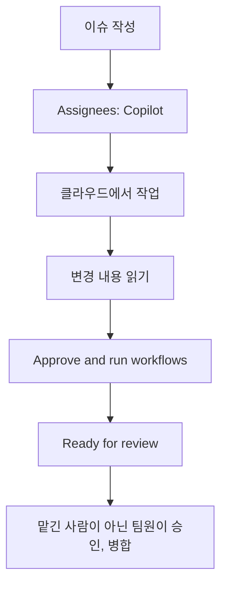

# 7교시. 책임 있는 사용과 보안 (45분)

!!! abstract "이번 교시의 목표"
    클라우드 에이전트에 일을 맡기고, Copilot 결과의 보안 위험을 찾아 고치며, 팀의 사용 규칙을 정할 수 있습니다.

| 구간 | 시간 |
|---|---|
| 이론 | 15분 |
| 실습 7-1 | 5분 |
| 실습 7-2 | 12분 |
| 실습 7-3 | 8분 |
| 정리 | 5분 |

실습 페이지:

- [실습 7-1 클라우드 에이전트에 맡기기](lab-1.md)
- [실습 7-2 보안 검토](lab-2.md)
- [실습 7-3 팀 사용 규칙과 정리](lab-3.md)

## 교안 { #lecture }

### 생성형 AI의 위험과 대응

| 위험 | 오늘 본 예 | 대응 |
|---|---|---|
| 환각 | 회의록에 없는 정책을 정함 (3교시) | 근거 대조, '확인 필요' 제약 |
| 틀린 코드 | 경계값 실수 (18시, 맞닿은 시간) | 테스트, 직접 실행 |
| 보안 취약점 | 예약 제목으로 스크립트 실행 (7-2) | 보안 검토 요청, 사람 리뷰 |
| 개인정보 노출 | 현황판에 연락처 공개 (6-3) | 필요한 것만 보여 주기 |
| 과한 신뢰 | 초록 체크 = 다 됐다 | 인수 조건으로 사람이 확인 |

오늘 하루 동안 생성형 AI의 위험을 이미 다 만나 봤어요. 회의록에 없는 정책을 정해 버린 환각, 경계값에서 틀린 코드, 곧 볼 보안 취약점, 현황판의 개인정보 노출, 그리고 초록 체크가 떴으니 다 됐다고 믿어 버리는 과한 신뢰예요. 대응은 늘 같아요. 근거와 대조하고, 테스트하고, 사람이 검토해요. GH-300 시험에서 책임 있는 사용이 15에서 20퍼센트를 차지해요.

### 클라우드 에이전트: 이슈를 맡기면 PR로 돌아옵니다



클라우드 에이전트는 예전에 coding agent라고 불리던 기능이에요. github.com에서 이슈의 Assignees에 Copilot을 지정하면, 클라우드 환경에서 작업하고 끝나면 PR을 열어요. 내 컴퓨터를 꺼도 일해요. AI Credits와 Actions 사용 시간을 함께 쓰니까 오늘은 팀당 한 건만 맡겨요. 이용률 보고서를 읽기 쉽게 리팩터링하는 일을 맡겨 볼 거예요. Copilot이 작업을 마치면 리뷰를 요청해요. 그때부터 절차가 있어요. 기본 설정에서는 Copilot이 올린 변경에 Actions가 자동으로 돌지 않아요. 먼저 변경 내용을 읽고, 쓰기 권한이 있는 사람이 Approve and run workflows를 눌러요. Copilot은 PR을 Ready for review로 바꾸거나 승인, 병합할 수 없어서 사람이 해요. 그리고 Copilot에게 일을 맡긴 사람은 그 PR을 승인할 수 없어요. 그래서 PM이 맡기고 BA가 승인해요. 작업이 수업 안에 안 끝나도 괜찮아요. 일을 맡겨 두고 다른 일을 하는 게 이 기능을 쓰는 이유예요.

### Copilot이 만든 코드도 보안 검토를 받아야 합니다

```text
지금:   <td>{r.title}</td>
제목에 <script>alert('예약')</script> 를 넣으면 현황판을 연 사람 브라우저에서 실행됩니다 (XSS)

고친 뒤: <td>{html.escape(r.title)}</td>
글자로만 보입니다
```

현황판을 만드는 코드는 예약 제목을 그대로 웹페이지에 넣어요. 그래서 누군가 제목에 스크립트를 넣으면, 현황판을 연 사람의 브라우저에서 그 스크립트가 실행돼요. 이런 걸 XSS, 크로스 사이트 스크립팅이라고 해요. 7-2에서 직접 재현하고, Copilot에게 보안 검토를 요청해 고쳐요. 고친 다음엔 Copilot이 제목만 고치고 예약자나 팀 이름은 빠뜨리지 않았는지 꼭 봐요. Copilot의 보안 제안도 검토 대상이에요.

### 개인 플랜에서 지킬 개인정보와 안전장치

개인 Pro 라이선스로 일할 때 지킬 것들이에요. 1교시에 바꾼 두 설정, 학습 사용 끄기와 공개 코드 Block을 다시 확인해요. 공개 코드와 일치하는 제안은 GitHub 문서 기준 인라인 제안의 1% 미만이에요. 콘텐츠 제외는 특정 파일이나 리포지토리를 Copilot이 아예 보지 못하게 하는 기능인데, Business와 Enterprise에만 있고 Pro에는 없어요. 그러니 개인 플랜에서는 키, 비밀번호, 고객 정보를 채팅에 붙이지 않는 습관이 더 중요해요.

### 더 알아 둘 Copilot 기능

| 기능 | 한 줄 설명 | 시작하는 법 |
|---|---|---|
| Copilot CLI | 터미널에서 대화하며 작업 | 설치 후 copilot 실행, /login |
| MCP | 외부 도구, 서비스를 Copilot에 연결 | 명령 MCP: Add Server |
| GitHub MCP 서버 | 이슈, PR을 Copilot이 직접 다룸 | api.githubcopilot.com/mcp/ |
| Spaces | 자료를 모아 두고 질문 | github.com/copilot/spaces |
| Agents 창 | 여러 에이전트 작업을 한 곳에서 | Open in Agents |

오늘 다 못 했지만 알아 두면 좋은 기능들이에요. Copilot CLI는 터미널에서 Copilot과 대화하며 작업하는 도구예요. MCP는 Model Context Protocol의 약자로, 외부 도구나 서비스를 Copilot에 연결하는 표준이에요. GitHub MCP 서버를 연결하면 Copilot이 이슈나 PR을 직접 다룰 수 있어요. Spaces는 자료를 모아 두고 그걸 근거로 질문하는 공간이에요. Agents 창은 여러 에이전트 작업을 한곳에서 관리해요. 모두 가이드 부록에 시작하는 법을 적어 두었어요.

### 팀의 Copilot 사용 규칙을 지침 파일로 남깁니다

```text title=".github/copilot-instructions.md (팀 규칙 예)"
- 공개 현황판에는 연락처와 전체 이름을 표시하지 않는다.
- HTML에 넣는 값은 html.escape()로 처리한다.
- 기능을 바꾸면 tests/에 테스트를 추가한다.
- 회의록에 없는 정책은 정하지 말고 질문한다.
- 모든 변경은 PR과 사람 리뷰를 거친다.
```

오늘 겪은 실수들을 팀 규칙으로 남겨요. 공개 현황판에 연락처와 전체 이름을 표시하지 않기, HTML에 넣는 값은 이스케이프하기, 기능을 바꾸면 테스트 추가하기, 회의록에 없는 정책 정하지 않기, 모든 변경은 사람 리뷰 거치기. 이걸 팀 리포지토리의 지침 파일에 넣으면, 다음부터 Copilot이 이 규칙을 맥락으로 받아요. 지침 파일도 PR로 올려서 팀이 합의하고 병합해요.

### 오늘 하루 배운 것

오늘 하루를 정리할게요. 오전에는 GitHub 흐름을 다시 떠올리고 Copilot을 안전하게 설정했고, 인라인 제안과 질문과 /fix로 버그를 고쳤고, 좋은 프롬프트와 지침 파일을 만들었고, 에이전트로 기능을 구현해 테스트하고 PR로 반영했어요. 오후에는 팀이 요구를 정리해 각자 구현하고, 리뷰와 충돌 해결을 거쳐 병합하고, 병합하면 자동으로 배포되는 CI/CD를 만들었어요. 그리고 보안 문제를 찾아 고치고 팀 규칙을 남겼어요. 처음에 말한 원칙 기억나시죠. Copilot이 쓰고, 사람이 검토하고, 사람이 검증한다.

### GH-300 시험 범위와 오늘 실습

| 시험 영역 | 비중 | 오늘 실습 |
|---|---|---|
| 책임 있는 사용 | 15~20% | 1-1 설정, 3-1 환각, 7-2 보안 |
| Copilot 기능 사용 | 25~30% | 2교시 전체, 4교시 에이전트, 6-1 리뷰, 7-1 클라우드 에이전트 |
| 데이터와 구조 | 10~15% | 1교시 동작 원리, 크레딧 |
| 프롬프트와 맥락 | 10~15% | 3교시 전체 |
| 생산성 (테스트, 리팩터링) | 10~15% | 4-2 테스트, 7-1 리팩터링 |
| 개인정보, 안전장치 | 10~15% | 1-1, 7교시 개인정보 |

GH-300 시험 범위와 오늘 실습을 맞춰 봤어요. 2026년 8월 7일 기준 시험 범위예요. Copilot 기능 사용이 25에서 30퍼센트로 가장 크고, 책임 있는 사용이 15에서 20퍼센트, 나머지가 각각 10에서 15퍼센트예요. 시험을 보실 분은 Microsoft Learn의 GitHub Copilot Fundamentals 학습 경로로 정리하시면 좋아요.

## 실습

- [실습 7-1 클라우드 에이전트에 맡기기](lab-1.md)
- [실습 7-2 보안 검토](lab-2.md)
- [실습 7-3 팀 사용 규칙과 정리](lab-3.md)
