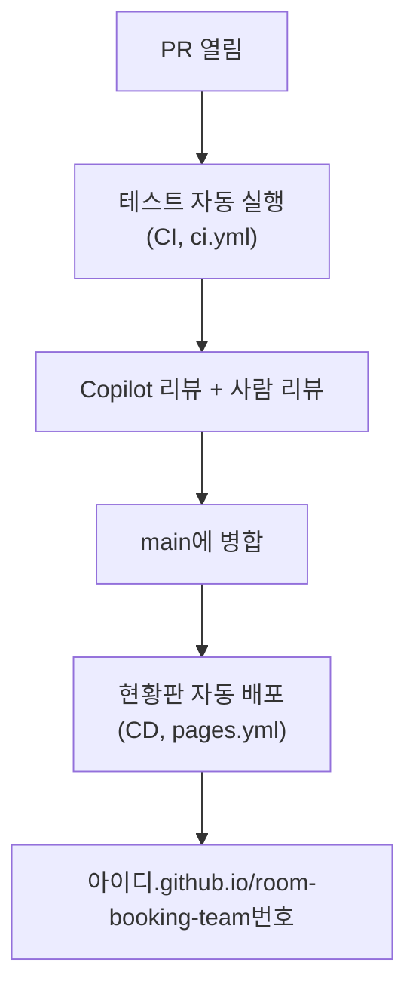

# GitHub Copilot (GH-300) 교안과 실습 가이드

GitHub Copilot 과정의 교안과 실습 가이드입니다. 수업 시간에는 강사 화면과 이 가이드를 나란히 띄워 두고 따라 하면 됩니다. 수업이 끝난 뒤에는 각 교시의 **교안** 페이지만 읽어도 복습이 되도록 썼습니다.

!!! abstract "이 과정에서 배우는 것"
    - VS Code에서 Copilot을 안전하게 설정하고, 인라인 제안, 인라인 채팅, Chat(Ask, Agent, Plan)을 구분해 쓰기
    - 좋은 프롬프트와 맥락으로 원하는 결과를 받고, 지침 파일과 프롬프트 파일로 팀이 같은 방식으로 쓰기
    - 에이전트로 기능을 구현하고, 변경을 검토하고, 테스트로 검증해 PR로 반영하기
    - Copilot 코드 리뷰와 사람 리뷰, Copilot으로 만든 배포 워크플로로 CI/CD 구성하기
    - Copilot 결과의 보안, 개인정보 위험을 찾아 고치고, 클라우드 에이전트에 일을 맡기기

!!! tip "오늘의 원칙"
    **Copilot이 쓰고, 사람이 검토하고, 사람이 검증합니다.** 코드를 몰라도 됩니다. 무엇을 원하는지 분명하게 요청하고, 바뀐 것을 읽고, 직접 돌려 보면 됩니다.

## 하루 시간표

| 시간 | 교시 | 주제 | 방식 | 실습 장소 |
|---|---|---|---|---|
| 09:00~09:50 | [1교시](class1/index.md) | GitHub 리마인드와 Copilot 시작 | 리마인드 15분 + 소개 10분 + 개인 실습 | 개인 `room-practice` |
| 10:00~10:50 | [2교시](class2/index.md) | Copilot 기본기 | 개념 + 개인 실습 | 개인 `room-practice` |
| 11:00~11:50 | [3교시](class3/index.md) | 프롬프트와 맥락 설계 | 개념 + 개인 실습 | 개인 `room-practice` |
| 12:00~13:15 | 점심 | | | |
| 13:15~14:05 | [4교시](class4/index.md) | 에이전트로 기능 만들기 | 개념 + 개인 실습 → 팀 구성 | 개인 → 팀 리포지토리 |
| 14:15~15:05 | [5교시](class5/index.md) | 팀 실습 ① 요구에서 구현까지 | 팀 역할극 | 팀 `room-booking-team<번호>` |
| 15:15~16:05 | [6교시](class6/index.md) | 팀 실습 ② 검토와 CI/CD | 팀 역할극 | 팀 리포지토리 |
| 16:15~17:00 | [7교시](class7/index.md) | 책임 있는 사용과 보안 (45분) | 기술 설명 + 실습 | 개인, 팀 리포지토리 |

모든 교시에 실습이 있습니다. 이론 약 35%, 실습 약 65%입니다.

## 실습 사례: 사내 회의실 예약 서비스

총무팀에서 "공유 엑셀로 회의실을 예약하다 보니 겹치는 예약, 정원 초과, 노쇼가 계속 생깁니다. 개선해 주세요"라는 요청이 왔다는 가상 상황입니다. 강사가 준비한 **Starter**(Python으로 만든 작은 예약 프로그램)에서 시작합니다.

| 들어 있는 것 | 쓰는 곳 |
|---|---|
| 현업 요청 메일, 킥오프 회의록, 현행 업무 (`docs/`) | 3교시 사용자 스토리, 5교시 요구 정리 |
| 예약 프로그램 (`booking/`), 예약 데이터 (`data/`) | 2, 4, 5교시 구현과 버그 수정 |
| 예약 현황판 만들기 (`build_site.py`) | 6교시 자동 배포, 7교시 보안 검토 |
| 테스트 (`tests/`), 테스트 자동 실행 (`.github/workflows/ci.yml`) | 4교시부터 매번 |

파일 내용은 [부록의 Starter 파일 보기](appendix/starter-files.md)에서 볼 수 있습니다.

## 하루가 끝나면 남는 것

팀 리포지토리에 겹침 검사, 정원 검사, 예약 취소가 들어간 서비스와, 병합하면 테스트하고 배포까지 자동으로 하는 CI/CD, 팀의 Copilot 사용 규칙(`.github/copilot-instructions.md`)이 남습니다.

## 시작하기 전에

[시작 전 준비](setup/1-install.md)부터 확인해 주세요. VS Code, Git, Python 설치와 Copilot Pro 확인 방법, 막혔을 때 대처법이 있습니다.
