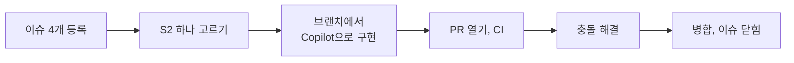

# 개인 미션 1. 스토리 하나를 끝까지: 이슈, 브랜치, 충돌, 병합

!!! abstract "이 미션에서 할 일"
    - 팀 실습 대신 **혼자서** 내 리포지토리에서 진행합니다.
    - 이슈(스토리) 4개를 등록하고, 이미 끝낸 2개는 닫고, **S2(정원 검사) 하나만** 골라 구현합니다.
    - PR을 열고, 일부러 만든 **병합 충돌**을 Copilot과 함께 풀고, 병합해서 이슈가 닫히는 것까지 봅니다.

**소요 시간** 약 30분  **실습 장소** 내 리포지토리 `room-practice` (VS Code와 github.com)

## 준비

- 실습 4-3까지 끝나 있어야 합니다. VS Code 상태 표시줄 브랜치가 `main`이고, 아래 테스트가 통과합니다.

    ```bash
    python -m pytest
    ```

- 조직에 리포지토리를 만들었다면 이 페이지의 `room-practice`를 내 리포지토리 이름으로, `<내아이디>`를 조직 이름으로 바꿔 읽습니다.

## 전체 흐름



## STEP 1. 이슈 4개 등록하기

할 일을 이슈로 적어 두는 것이 백로그입니다. 네 개를 손으로 쓰지 않고 **github.com의 Copilot 채팅에 초안을 맡기고, 사람은 검토하고 Create만 누릅니다.**

1. 브라우저 새 탭에서 `github.com/copilot`을 엽니다.
2. 아래를 붙여 넣고 `<내아이디>`를 바꾼 뒤 Enter를 누릅니다. 조직 리포지토리면 `<조직>/<리포지토리 이름>`으로 씁니다.

    ```text
    In <내아이디>/room-practice, 아래 스토리로 이슈를 하나씩 만들어 주세요.
    각 이슈 본문은 "## 스토리"(누구로서, 무엇을 원한다, 왜냐하면 한 문장), "## 바꿀 곳", "## 완료 기준"으로 써 주세요.
    1) [S1] 같은 회의실, 같은 날짜에 시간이 겹치는 예약을 막는다 / 바꿀 곳 booking/rules.py / 완료 기준 10:00-11:00이 있으면 10:30-11:30은 "이미 예약된 시간"으로 실패, 11:00-12:00은 성공
    2) [S2] 회의실 정원을 넘는 예약을 막는다 / 바꿀 곳 booking/rules.py / 완료 기준 소회의실 A(정원 4)에 5명이면 "정원을 넘었습니다"로 실패, 정원과 같은 4명은 성공
    3) [S3] 예약을 취소할 수 있다 / 바꿀 곳 booking/service.py, booking/__main__.py / 완료 기준 python -m booking cancel --id 3이면 #3이 목록에서 사라지고 "[취소 완료]" 출력. 없는 번호면 "[취소 실패] 없는 예약 번호입니다"
    4) [S4] 18:00에 끝나는 예약이 되게 고친다 / 바꿀 곳 booking/rules.py / 완료 기준 17:00-18:00 성공, 17:30-18:30 실패
    문서에 없는 정책(최대 예약 시간, 노쇼 자동 취소 등)은 넣지 마세요.
    시간 범위는 물결표(~) 대신 10:00-11:00처럼 하이픈(-)으로 써 주세요.
    ```

3. 초안이 이슈마다 따로 나옵니다. 하나씩 아래를 확인하고 고친 뒤 **Create**를 누릅니다.
    - 제목이 `[S1]`처럼 번호로 시작하는가
    - 본문에 스토리, 바꿀 곳, 완료 기준이 있는가
    - 시키지 않은 정책이나 숫자가 끼어 있지 않은가. 있으면 지웁니다

!!! note "Copilot 초안 기능이 안 보이면: 직접 만들기"
    미리 보기 기능이라 계정에 따라 안 보일 수 있습니다. 그때는 내 리포지토리 → **Issues** 탭 → **New issue**에서 아래 제목과 본문을 붙여 넣고 **Create**를 클릭합니다. 네 번 반복합니다.

=== "S1 겹침"

    ```text
    [S1] 같은 회의실, 같은 날짜에 시간이 겹치는 예약을 막는다
    ```

    ```text
    ## 바꿀 곳
    booking/rules.py

    ## 완료 기준
    10:00-11:00이 있으면 10:30-11:30은 "이미 예약된 시간"으로 실패. 11:00-12:00은 성공
    ```

=== "S2 정원"

    ```text
    [S2] 회의실 정원을 넘는 예약을 막는다
    ```

    ```text
    ## 스토리
    총무 담당자로서, 회의실 정원을 넘는 예약을 막고 싶다. 의자를 빌리러 다니는 일을 없애기 위해서다.

    ## 바꿀 곳
    booking/rules.py

    ## 완료 기준
    - 소회의실 A(정원 4)에 5명이면 "정원을 넘었습니다"로 실패
    - 정원과 같은 4명은 성공
    ```

=== "S3 취소"

    ```text
    [S3] 예약을 취소할 수 있다
    ```

    ```text
    ## 바꿀 곳
    booking/service.py, booking/__main__.py

    ## 완료 기준
    python -m booking cancel --id 3이면 #3이 목록에서 사라지고 "[취소 완료]" 출력. 없는 번호면 "[취소 실패] 없는 예약 번호입니다"
    ```

=== "S4 18시"

    ```text
    [S4] 18:00에 끝나는 예약이 되게 고친다
    ```

    ```text
    ## 바꿀 곳
    booking/rules.py

    ## 완료 기준
    17:00-18:00 성공, 17:30-18:30 실패
    ```

이슈 4개가 만들어지면 이어서 합니다.

1. 내 리포지토리 **Issues** 탭을 엽니다. S1(4교시에 구현)과 S4(2교시에 수정)는 이미 끝낸 일입니다. 각 이슈를 열고 아래 댓글을 쓴 뒤 **Close issue**(이슈 닫기)를 클릭합니다.

    ```text
    오전 실습에서 구현하고 main에 병합했습니다.
    ```

2. **S2 이슈의 번호**(제목 옆 `#숫자`)를 메모합니다. 이 페이지에서는 `<번호>`로 씁니다.

확인: **Issues** 탭에 열린 이슈가 S2, S3 두 개이고, 닫힌 이슈(**Closed**)가 S1, S4 두 개입니다. 오늘은 S2만 합니다. S3은 백로그에 남겨 둡니다.

!!! warning "시간은 10:00-11:00처럼 하이픈으로 씁니다"
    GitHub 이슈와 댓글에서는 물결표 두 개 사이의 글자가 취소선으로 바뀝니다.

## STEP 2. 브랜치 `capacity-check` 만들기

1. VS Code에서 상태 표시줄 브랜치가 `main`인지 보고, 동기화 아이콘을 눌러 최신으로 맞춥니다.
2. 브랜치 이름 `main` 클릭 → **Create new branch...** → 이름 입력 → ++enter++

    ```text
    capacity-check
    ```

확인: 상태 표시줄에 `capacity-check`가 보입니다.

## STEP 3. 이슈를 근거로 구현하기

1. Chat 보기 **+**(**New Chat**) → Session Target **Copilot**, Agent **Agent**, 권한 **Manual**인지 봅니다.
2. github.com에서 S2 이슈 본문 전체를 복사합니다.
3. Chat에 붙여 넣기. `(여기에 이슈 본문)` 자리에 복사한 내용을 넣습니다.

    ```text
    아래 GitHub 이슈를 구현하고 테스트를 추가해 주세요.
    - 정원 검사는 booking/rules.py의 validate() 함수 마지막 줄 return errors 바로 위에 넣어 주세요.
    - 테스트는 tests/test_rules.py 맨 끝에 추가해 주세요.
    - 기존 코드와 기존 테스트는 지우거나 바꾸지 마세요.
    - 이슈에 없는 기능은 넣지 마세요.
    - 다 되면 python -m pytest를 실행해 결과를 보여 주세요.

    (여기에 이슈 본문)
    ```

4. 승인 요청이 뜨면 무엇을 실행하는지 읽고 승인합니다.
5. 소스 제어 보기의 **Changes** 목록에서 diff를 읽습니다. 바뀐 파일이 `booking/rules.py`, `tests/test_rules.py` 둘뿐인지 봅니다.

확인: 테스트에 `failed`가 없고, 정원 초과와 정원 딱 맞음 테스트가 추가되어 있습니다.

## STEP 4. 완료 기준대로 직접 확인하기

```bash
python -m booking add --room R1 --title 정원초과 --date 2026-11-13 --start 10:00 --end 11:00 --booker 홍길동 --attendees 5
```

```text
[예약 실패]
 - 정원을 넘었습니다: 소회의실 A 정원 4명, 참석 5명
```

```bash
python -m booking add --room R1 --title 정원딱맞음 --date 2026-11-13 --start 10:00 --end 11:00 --booker 홍길동 --attendees 4
```

```text
[예약 완료] #6 2026-11-13 10:00~11:00 R1 정원딱맞음
```

메시지 문장은 조금 달라도 됩니다. 5명은 실패, 4명은 성공이면 됩니다. 확인을 마치면 **소스 제어**에서 `data/reservations.json`의 되돌리기 아이콘(**Discard Changes**)을 클릭합니다.

확인: 소스 제어에 `data/reservations.json`이 없습니다.

## STEP 5. 커밋하고 올리기

1. 메시지를 입력하고 **Commit**을 클릭합니다. `<번호>`는 S2 이슈 번호로 바꿉니다.

    ```text
    정원 검사와 테스트 추가 (#<번호>)
    ```

2. **Publish Branch**를 클릭합니다.

확인: 소스 제어 버튼이 사라졌습니다.

## STEP 6. 동료 역할: main을 먼저 고치기 (충돌 만들기)

실제 팀에서는 내가 작업하는 동안 동료가 같은 파일을 먼저 고쳐 병합합니다. 혼자서 그 상황을 만듭니다. 이번에는 **github.com에서 main을 직접** 고칩니다.

1. github.com 내 리포지토리 **Code** 탭에서 브랜치가 `main`인지 보고 `booking` → `rules.py`를 클릭합니다.
2. 오른쪽 위 연필 아이콘(**Edit this file**)을 클릭합니다.
3. `validate()` 함수의 마지막 줄 `return errors`를 찾습니다. 그 **바로 윗줄**에 아래 한 줄을 추가합니다. 앞의 공백 4칸도 맞춥니다.

    ```python
        # 동료가 추가: 검사를 모두 마친 뒤 오류 목록을 돌려준다
    ```

4. 오른쪽 위 **Commit changes...**를 클릭합니다. **Commit directly to the main branch**가 선택된 채로 **Commit changes**를 클릭합니다.

확인: main의 `rules.py`에 주석 한 줄이 들어갔습니다. 내 브랜치 `capacity-check`에는 이 줄이 없습니다.

## STEP 7. PR 열기

1. 내 리포지토리 위쪽 노란 띠의 **Compare & pull request**를 클릭합니다. 띠가 없으면 **Pull requests** → **New pull request** → **compare**를 `capacity-check`로 고릅니다.
2. 제목을 입력합니다.

    ```text
    [S2] 정원을 넘는 예약 막기
    ```

3. 설명 칸 도구 모음의 Copilot 아이콘 → **Summary**를 클릭하고, 하지 않은 일이 적혀 있으면 고칩니다.
4. 맨 아래에 덧붙입니다. `<번호>`는 S2 이슈 번호입니다.

    ```text
    직접 확인: 5명 실패, 4명 성공

    Closes #<번호>
    ```

5. **Create pull request**를 클릭합니다.

확인: PR 아래쪽에 **This branch has conflicts that must be resolved**(이 브랜치에 해결해야 할 충돌이 있습니다)가 보입니다. 정상입니다. STEP 6에서 같은 자리를 서로 다르게 고쳤기 때문입니다.

!!! tip "Closes #번호"
    PR 설명에 `Closes #<번호>`가 있으면 이 PR이 병합될 때 그 이슈가 자동으로 닫힙니다.

## STEP 8. 충돌 해결하기

=== "github.com에서"

    1. PR 아래쪽 **Resolve conflicts**(충돌 해결)를 클릭합니다.
    2. 편집기에서 아래처럼 표시된 부분을 찾습니다.

        ```text
        <<<<<<< capacity-check
        (내 브랜치의 정원 검사 코드)
        =======
        (main에 먼저 들어간 주석)
        >>>>>>> main
        ```

    3. 그 부분을 복사해 VS Code Chat(**Ask**)에 붙여 넣습니다.

        ```text
        병합 충돌입니다. 위쪽은 내 브랜치(정원 검사), 아래쪽은 main에 먼저 들어간 변경입니다.
        각각 무엇인지 설명하고, 둘 다 남도록 합친 코드를 보여 주세요. 충돌 표시 줄(<<<, ===, >>>)은 빼 주세요.
        (여기에 충돌 부분)
        ```

    4. 답을 읽고, **정원 검사와 주석이 모두 남는지** 확인한 뒤 편집기의 충돌 부분을 합친 코드로 바꿉니다. `<<<<<<<`, `=======`, `>>>>>>>` 줄이 남지 않게 합니다.
    5. **Mark as resolved**(해결됨으로 표시) → **Commit merge**(병합 커밋)를 클릭합니다.

=== "VS Code에서"

    github.com에 **Resolve conflicts** 버튼이 없으면 이 방법을 씁니다.

    1. 상태 표시줄 브랜치가 `capacity-check`인지 봅니다.
    2. 명령 팔레트(Windows ++ctrl+shift+p++, Mac ++cmd+shift+p++)에서 `Git: Fetch`를 실행합니다.
    3. 명령 팔레트에서 `Git: Merge Branch...`를 실행하고 `origin/main`을 고릅니다.
    4. 소스 제어에 충돌 파일 `rules.py`가 나옵니다. 파일을 열고 **Resolve in Merge Editor**(병합 편집기에서 해결)를 클릭합니다.
    5. 양쪽을 모두 받아들이고, 아래 결과 창에 정원 검사와 주석이 모두 있는지 본 뒤 **Complete Merge**를 클릭합니다.
    6. 커밋하고 **Sync Changes**로 올립니다.

    !!! note "화면이 조금 다를 수 있어요"
        병합 편집기의 버튼 이름은 VS Code 버전에 따라 다를 수 있습니다. 결과에 양쪽 내용이 모두 있고 충돌 표시 줄이 없으면 됩니다.

확인: PR의 충돌 표시가 사라졌고, **테스트 / test**가 다시 돌아 초록 체크가 됩니다.

!!! warning "충돌 해결은 최종 내용을 정하는 일입니다"
    같은 파일이라도 다른 줄을 고쳤으면 보통 자동으로 합쳐집니다. 같은 자리를 서로 다르게 고쳤을 때만 사람이 정합니다. 이번에는 둘 다 필요하므로 모두 남깁니다. 빨리 없애려고 한쪽을 지우면 기능이 조용히 사라집니다. Copilot이 합친 코드도 그대로 믿지 말고 직접 봅니다.

## STEP 9. 병합하고 마무리하기

1. **테스트 / test**가 초록이면 **Merge pull request** → **Confirm merge**를 클릭합니다.
2. **Delete branch**를 클릭합니다.
3. **Issues** 탭을 엽니다. S2 이슈가 닫혀 있는지 봅니다.
4. VS Code에서 브랜치를 `main`으로 바꾸고 동기화 아이콘을 누릅니다.
5. 터미널에서 테스트를 돌립니다.

    ```bash
    python -m pytest
    ```

확인: PR이 보라색 **Merged**, S2 이슈가 **Closed**, 내 PC의 main에 정원 검사와 동료의 주석이 모두 있고 테스트가 통과합니다.

## 다 됐는지 확인

- [ ] 이슈 4개를 등록했고, S1과 S4는 닫았다
- [ ] `capacity-check` 브랜치에서 Copilot으로 S2를 구현하고 직접 확인했다
- [ ] PR에서 충돌을 보고, 양쪽을 모두 남겨 해결했다
- [ ] **테스트 / test**가 초록인 상태에서 병합했다
- [ ] S2 이슈가 자동으로 닫혔다

다음: [개인 미션 2. 배포 자동화](mission-2.md)

## 막히면

??? failure "PR에 충돌 표시가 안 나와요"
    STEP 6의 주석을 `return errors` 바로 윗줄이 아닌 곳에 넣었거나, Copilot이 정원 검사를 다른 자리에 넣은 경우입니다. Git이 자동으로 합친 것이라 문제는 아닙니다. 그대로 STEP 9로 갑니다. 충돌을 꼭 보고 싶으면 github.com에서 main의 `rules.py`에서 내 PR이 고친 줄(**Files changed** 탭의 초록 줄 바로 위아래)을 한 번 더 고칩니다.

??? failure "Resolve conflicts 버튼이 회색이에요"
    github.com 편집기로 풀 수 없는 충돌입니다. STEP 8의 **VS Code에서** 탭으로 합니다.

??? failure "충돌을 풀었는데 테스트 / test가 빨간 X예요"
    충돌 표시 줄이 남았거나 들여쓰기가 틀어진 경우가 많습니다. VS Code에서 `capacity-check` 브랜치로 **Sync Changes**를 눌러 받아 온 뒤, 오류를 Chat에 붙여 넣어 고치고 커밋, **Sync Changes**를 합니다.

??? failure "push할 때 Repository not found가 나와요"
    리포지토리가 없는 것이 아니라 로그인한 계정에 권한이 없는 것입니다. VS Code 왼쪽 아래 계정 아이콘에서 로그아웃하고, 리포지토리에 쓰기 권한이 있는 계정으로 다시 로그인합니다.

??? failure "이슈가 자동으로 안 닫혀요"
    PR 설명에 `Closes #<번호>`가 없었던 것입니다. 이슈를 열어 **Close issue**로 직접 닫습니다.
