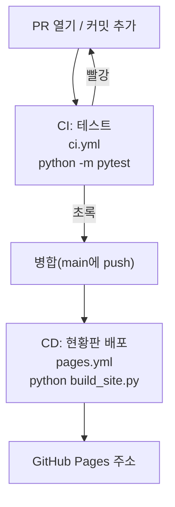

# 개인 미션 2. Copilot으로 배포 자동화 (CD)

!!! abstract "이 미션에서 할 일"
    - 브랜치 `add-pages`에서 Copilot Agent에게 배포 워크플로 `.github/workflows/pages.yml`(이름 "현황판 배포")을 만들게 합니다.
    - 체크리스트로 워크플로를 검토하고 PR로 병합합니다.
    - main에 병합되면 현황판이 GitHub Pages 주소로 자동 배포되는 것을 확인합니다.

**소요 시간** 약 15분  **실습 장소** 내 리포지토리 `room-practice` (VS Code와 github.com)

## 준비

- [개인 미션 1](mission-1.md)을 마쳤으면 좋습니다. 덜 끝났어도 이 미션은 시작할 수 있습니다.

!!! info "CD가 뭔가요?"
    CD(Continuous Deployment, 지속적 배포)는 main에 병합될 때마다 결과물을 자동으로 내보내는 것입니다. 여기서는 `python build_site.py`로 만든 현황판 `site/index.html`을 GitHub Pages(GitHub가 제공하는 웹페이지 호스팅)에 올립니다. `site/` 폴더는 `.gitignore`에 들어 있어 커밋되지 않습니다. 그래서 GitHub Actions가 서버에서 직접 만들어 올립니다.

## STEP 1. Pages 설정 바꾸기

1. github.com 내 리포지토리 → **Settings** → 왼쪽 메뉴 **Pages**를 클릭합니다.
2. **Build and deployment** 아래 **Source**를 **GitHub Actions**로 바꿉니다.
3. 아래에 추천 워크플로 카드가 나와도 누르지 않습니다.

확인: **Source**가 **GitHub Actions**로 보입니다.

## STEP 2. 브랜치 `add-pages` 만들기

1. VS Code에서 상태 표시줄 브랜치가 `main`인지 보고, 동기화 아이콘을 눌러 최신으로 맞춥니다.
2. 브랜치 이름 `main` 클릭 → **Create new branch...** → 이름 입력 → ++enter++

    ```text
    add-pages
    ```

확인: 상태 표시줄에 `add-pages`가 보입니다.

## STEP 3. Agent에게 워크플로 만들게 하기

1. Chat 보기 **+**(**New Chat**) → Session Target **Copilot**, Agent **Agent**를 고릅니다.
2. **+**(**Add Context**) → **Files & Folders**로 `build_site.py`, `.github/workflows/ci.yml`을 추가합니다.
3. Chat에 붙여 넣기

    ```text
    GitHub Pages 배포 워크플로를 만들어 주세요.
    - 파일: .github/workflows/pages.yml
    - 워크플로 이름: 현황판 배포
    - 실행 시점: main에 push될 때, 그리고 수동 실행(workflow_dispatch)
    - 할 일: Python 3.12로 python build_site.py를 실행해 site/ 폴더를 만들고, site/ 폴더를 GitHub Pages에 배포
    - GitHub 공식 Pages 액션(configure-pages, upload-pages-artifact, deploy-pages)을 써 주세요.
    - 필요한 권한(permissions)만 최소로 주세요.
    - 다른 파일은 바꾸지 마세요.
    - 다 만든 뒤 각 단계가 무엇을 하는지 한 줄씩 설명해 주세요.
    ```

4. 승인 요청이 뜨면 읽고 승인합니다.

확인: `.github/workflows/pages.yml`이 새로 생겼고, 채팅에 단계별 설명이 있습니다.

## STEP 4. 워크플로 검토하기

Copilot이 만든 워크플로는 매번 조금씩 다릅니다. 순서나 버전 숫자가 달라도, 아래 항목이 모두 있으면 됩니다.

| 확인 | 찾을 내용 | 왜 필요한가 |
|---|---|---|
| 이름 | `name: 현황판 배포` | Actions 탭에서 찾는 이름 |
| 실행 시점 | `on:` 아래 `push:`와 `branches: [main]` | main에 병합될 때만 배포 |
| 수동 실행 | `workflow_dispatch:` | 손으로 다시 배포 |
| 권한 | `contents: read`, `pages: write`, `id-token: write` | 코드를 읽고 Pages에 배포하는 데 필요 |
| 배포 환경 | `environment:` 아래 `name: github-pages` | GitHub 문서가 요구하는 항목 |
| 코드 받기 | `actions/checkout` | 저장소 파일을 가져옴 |
| Python 준비 | `actions/setup-python`과 3.12 | `build_site.py` 실행 환경 |
| 사이트 만들기 | `run: python build_site.py` | `site/index.html` 생성 |
| 설정 | `actions/configure-pages` | Pages 배포 준비 |
| 올리기 | `actions/upload-pages-artifact`와 `path: site` | `site/` 폴더를 배포 묶음으로 |
| 배포 | `actions/deploy-pages` | 실제 배포 |

빠진 것이 있으면 Chat에 요청합니다. 예:

```text
permissions에 pages: write와 id-token: write가 없습니다. 추가해 주세요.
```

확인: 표의 항목을 모두 찾았습니다.

!!! warning "권한은 최소로"
    Copilot이 `contents: write`나 `permissions: write-all`처럼 넓은 권한을 넣었다면 줄여 달라고 요청합니다. 워크플로 권한도 사람이 검토해야 하는 부분입니다.

## STEP 5. 커밋하고 PR로 병합하기

1. **소스 제어**에서 바뀐 파일이 `.github/workflows/pages.yml` 하나인지 봅니다.
2. 메시지를 입력하고 **Commit** → **Publish Branch**를 클릭합니다.

    ```text
    현황판 배포 워크플로 추가
    ```

3. github.com에서 **Compare & pull request** → 제목 `현황판 배포 워크플로 추가` → **Create pull request**를 클릭합니다.
4. **테스트 / test**가 초록이 되면 **Merge pull request** → **Confirm merge** → **Delete branch**를 클릭합니다.

확인: PR이 보라색 **Merged**입니다. "현황판 배포"는 main에 push될 때만 돌기 때문에 PR 검사에는 보이지 않는 것이 정상입니다.

## STEP 6. 배포 확인하기

1. 위쪽 **Actions** 탭 → 왼쪽 **현황판 배포**를 클릭합니다.
2. 맨 위 실행 기록이 노란 원에서 초록 체크가 될 때까지 1~2분 기다립니다.
3. 실행 기록을 클릭하면 **deploy** 상자 아래에 배포 주소가 보입니다. 클릭합니다.

    ```text
    https://<내아이디>.github.io/room-practice/
    ```

확인: "회의실 예약 현황" 페이지가 열리고 예약 5건이 보입니다.

## STEP 7. CI와 CD 정리



| 구분 | 워크플로 | 언제 | 무엇을 |
|---|---|---|---|
| CI | `ci.yml` "테스트" | PR, main push | 테스트 자동 실행 |
| CD | `pages.yml` "현황판 배포" | main push, 수동 | 현황판 만들고 배포 |

!!! tip "7교시 실습은 내 리포지토리에서"
    7교시 페이지에 "팀 리포지토리"라고 적힌 곳은 내 리포지토리 `room-practice`로 바꿔 읽습니다.

## 다 됐는지 확인

- [ ] `add-pages` 브랜치에서 `pages.yml`을 Copilot으로 만들고 검토 표로 확인했다
- [ ] PR을 병합했다
- [ ] **Actions**에서 **현황판 배포**가 초록 체크다
- [ ] 배포 주소에서 현황판이 열린다

## 막히면

??? failure "configure-pages 단계에서 Get Pages site failed, Not Found가 나와요"
    STEP 1을 건너뛴 것입니다. **Settings** → **Pages** → **Source**를 **GitHub Actions**로 바꾼 뒤, **Actions** → 실패한 **현황판 배포** 실행을 열고 오른쪽 위 **Re-run jobs** → **Re-run failed jobs** → **Re-run jobs**를 클릭합니다.

??? failure "Source에 GitHub Actions가 없어요"
    리포지토리가 Private이고 Pages를 쓸 수 없는 플랜입니다. **Settings** → **General** 맨 아래 **Danger Zone** → **Change visibility**로 Public으로 바꿉니다. 조직 리포지토리라 바꿀 수 없으면 강사에게 알립니다.

??? failure "권한(permission) 오류가 나와요"
    워크플로에 `pages: write`, `id-token: write`가 있는지 봅니다. 없으면 새 브랜치에서 Copilot에게 추가를 요청하고 PR로 다시 병합합니다.

??? failure "주소가 404예요"
    배포 직후에는 1~2분 걸릴 수 있습니다. 새로 고침합니다. 주소 끝에 `/`가 있는지도 봅니다.
